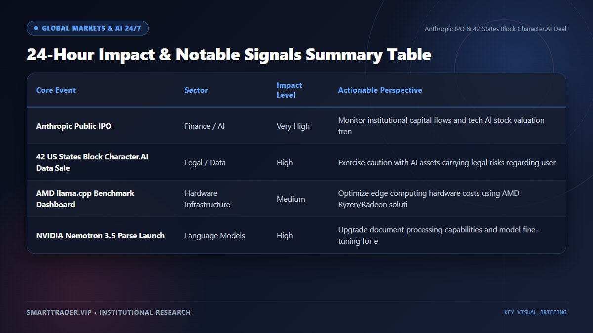

## 24-Hour Macro & Technology Overview

*Archival photo: As Anthropic IPOs, Grand Theft Auto VI proves why efficiency isn’t a virtue (Source: TechCrunch AI)*

The global financial and technology markets over the past 24 hours have witnessed historic turning points as the boundary between large-scale tech valuations and human-centric data stewardship faces intense scrutiny. **[TechCrunch AI]** reports a groundbreaking development as **Anthropic officially enters the public markets via IPO**, opening a new era for institutional capital deployment into leading large language models. Concurrently, regulatory pressure from state authorities is mounting unprecedentedly, highlighted by **[The Verge AI] noting that 42 US state attorneys general are joining forces to block Character.AI from selling user chat data** amid its Chapter 11 bankruptcy proceedings. This dichotomy reflects a volatile macroeconomic landscape: on one hand, massive capital craving AI efficiency and speed; on the other hand, stringent regulatory walls designed to safeguard individual privacy.

## AI Breakthroughs, Model Infrastructure & Agent Ecosystems

The race for AI infrastructure and computational efficiency optimization is unfolding aggressively across both hardware and software fronts.

- **[TechCrunch AI] As Anthropic IPOs, Grand Theft Auto VI proves why efficiency isn’t a virtue**: Anthropic's IPO coincides with Grand Theft Auto VI cementing its status as a multi-year, human-crafted entertainment blockbuster, raising fundamental questions about whether complete AI optimization should be the ultimate priority or if craft-driven values remain the key to success. This event forces venture capitalists to recalibrate asset allocation strategies between pure-play AI startups and deep traditional creative industries. [Read more on TechCrunch](https://techcrunch.com/2026/11/26/as-anthropic-ipos-grand-theft-auto-vi-proves-why-efficiency-isnt-a-virtue/)

- **[Hugging Face Blog] Introducing the llama.cpp benchmark dashboard for AMD Ryzen and Radeon**: The open-source community welcomes a new benchmarking tool designed to optimize LLM performance on AMD Ryzen and Radeon hardware lines. This move breaks single-vendor hardware monopolies in AI training and inference, delivering cost-efficient solutions for small- and medium-scale infrastructure developers. [Read more on Hugging Face](https://huggingface.co/blog/ggml-org/llamacpp-amd-bench)

- **[Hugging Face Blog] Building on Nemotron 3.5 Parse: Open Data, Fine-Tuning, and Faster Inference**: NVIDIA continues to reinforce its hardware-software synergy via the Nemotron 3.5 Parse toolkit, focusing on open data, fine-tuning capabilities, and superior inference speeds. These enhancements significantly reduce latency for enterprise AI systems requiring real-time, complex document processing. [Read more on Hugging Face](https://huggingface.co/blog/nvidia/building-on-nemotron-35-parse-open-data-finetunin)

- **[Hugging Face Blog] Swarms, Flocks, Gangs: How to build, train, and evaluate multi-agent systems**: The trend in multi-agent architectures enters a new chapter with advanced methodologies for building, training, and evaluating complex agent networks. Agent group orchestration is rapidly becoming a focal point of research to solve large-scale enterprise automation tasks. [Read more on Hugging Face](https://huggingface.co/blog/training-swarms)

## Market Movements, Regulations & Data Risks

The AI explosion brings unprecedented regulatory challenges concerning user rights and intellectual property.

- **[The Verge AI] 42 state AGs are trying to stop Character.AI from selling users’ chats**: A coalition of 42 US state attorneys general is mounting intense pressure to block Character.AI from monetizing sensitive user chat data during its Chapter 11 bankruptcy proceedings. This move sets a critical legal precedent regarding personal data ownership when AI companies face financial distress, while directly threatening M&A valuations for AI assets containing user data. [Read more on The Verge](https://www.theverge.com/policy/1042620/character-ai-sale-state-ags-block-selling-users-chats)

## 24-Hour Impact & Notable Signals Summary Table

*Visual summary: 24-Hour Impact & Notable Signals Summary Table*

| Core Event | Sector | Impact Level | Actionable Perspective |
| :--- | :--- | :--- | :--- |
| **Anthropic Public IPO** | Finance / AI | Very High | Monitor institutional capital flows and tech AI stock valuation trends |
| **42 US States Block Character.AI Data Sale** | Legal / Data | High | Exercise caution with AI assets carrying legal risks regarding user privacy |
| **AMD llama.cpp Benchmark Dashboard** | Hardware Infrastructure | Medium | Optimize edge computing hardware costs using AMD Ryzen/Radeon solutions |
| **NVIDIA Nemotron 3.5 Parse Launch** | Language Models | High | Upgrade document processing capabilities and model fine-tuning for enterprises |
| **Multi-Agent Swarms Ecosystem** | AI Architecture | Medium | Research applications of multi-agent networks in business process automation |

## 60-Second Quick Read

- **Anthropic officially goes public via IPO**, marking a major milestone for top-tier AI startups entering public financial markets.
- **42 US state attorneys general** coordinate actions to block Character.AI from selling chat data amid Chapter 11 bankruptcy, tightening user data governance.
- **Hugging Face and AMD** partner to launch the llama.cpp benchmark dashboard, driving AI performance on consumer-grade hardware.
- **NVIDIA rolls out Nemotron 3.5 Parse**, optimizing open data and inference speed for enterprise systems.
- **Multi-Agent architectures** continue to draw heavy attention as training methodologies for collaborative agent networks mature.

---
## 🎯 Exclusive Portals & Trading Tools
- ⚡ **Real-Time Live Signal Framework:** [Trading Signal VIP](https://smarttrader.vip/vip-trading-signals)
- 🤖 **Myfxbook EA Bot Performance Verification:** Access [Automated Bot Trading](https://smarttrader.vip/automated-bot-trading) immediately to view real track records with a Max Drawdown under 10%.
- 🌐 **Automation Infrastructure:** [MMO Infrastructure](https://smarttrader.vip/mmo-infrastructure)
- ✈️ **Receive Daily Newsletters:** Join the [MCG Community Telegram Channel](https://t.me/channelmcg).