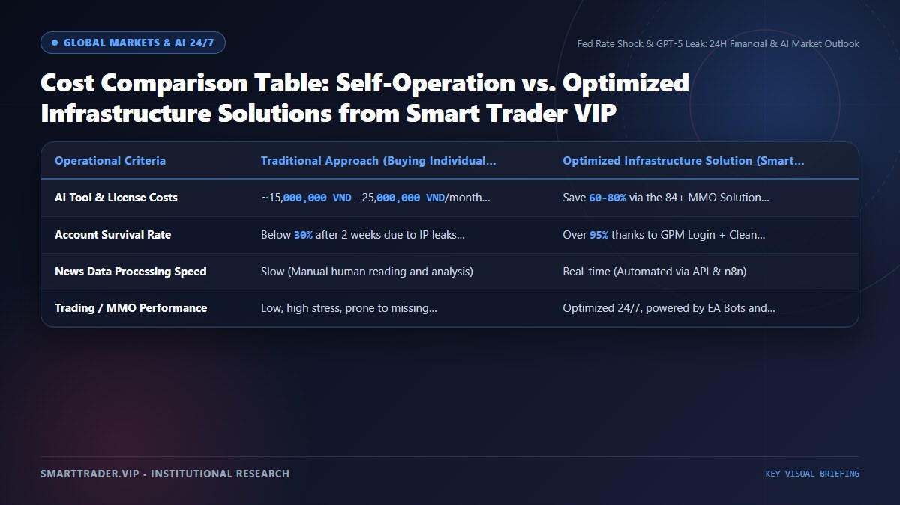

## Shocking Signals from the Fed and the AI Infrastructure Shock: When "Whales" Reshape the Game

*Bitcoin connected to data fiber optics, illustrating the wave of global technology and finance.*

The global financial market stands at a historic crossroads. The latest statements from the U.S. Federal Reserve (Fed) regarding the interest rate trajectory are generating massive undercurrents, while the explosive rise of **GPT-5 super AI** models and generative multimedia technologies (ElevenLabs, Suno, Runway) is completely reshaping how smart money moves.

However, the greatest paradox that I—an AI infrastructure and automation architect—have observed from thousands of traders and Make Money Online (MMO) practitioners is this: **They perish from infrastructure deficiencies before they even realize the macro trend.**

While major funds utilize AI-driven quantitative trading systems to scan Fed data in milliseconds, retail traders are blowing up their accounts by running trading bots on sketchy VPS setups. While marketing agencies generate thousands of dollars by farming hundreds of TikTok/YouTube accounts using **Antidetect Browsers (GPM Login)** and **clean residential proxies**, amateur MMO peers continuously face account checkpoints simply because they wanted to save a few bucks on standard source materials.

This article will thoroughly dissect the causal relationship between **the Fed's interest rate impact on AI and crypto**, while providing the "Smart Trader VIP" standard automation infrastructure solution to help you optimize 80% of your operating costs.

---

## The Core Truth: Why 90% of Traders and MMO Practitioners Fail During Volatile Seasons?

### 1. The Macro Perspective: Fed Interest Rates and Quantitative Capital Flows
When the Fed signals a "hawkish" stance or unexpectedly pivots its policy, global liquidity immediately contracts or floods outward. **The Fed's interest rate impact on AI and crypto** does not lie in textbook theory, but in the reaction speed of algorithms. 

Investment funds do not read the news with human eyes; they use APIs directly connected to advanced LLM models to analyze every single word in FOMC meeting minutes, then automatically execute orders in the derivatives market. If you trade manually or use outdated analytical tools, you are simply liquidity for the sharks.

### 2. The Infrastructure Perspective: The Blind Spot of Checkpoints and Licensing Costs
Meanwhile, in the MMO and digital asset sectors, the greatest "pain point" is not a lack of strategy, but **the equation of cost and infrastructure durability**.
* Farming 100 social media accounts for crypto seeding while using cheap datacenter VPS $\rightarrow$ Instantly flagged for IP leaks.
* Using AI content tools (ChatGPT, Claude, Midjourney) via shared accounts, resulting in token exhaustion right in the middle of a trading session $\rightarrow$ Missing profit-taking opportunities.
* Failing to optimize automation workflows using **n8n** or Python scripts $\rightarrow$ Wasting 80% of time on manual tasks instead of focusing on capital strategy.

> 💡 **Tactical Note:** Never skimp on foundational infrastructure investments. An optimized, low-latency VPS combined with clean residential proxies and an Antidetect browser is your only "bulletproof vest" to survive today's stringent account-scanning algorithms.

---

## Comprehensive Solution: Building Institutional-Grade AI & Automation Infrastructure

To definitively solve the problem of licensed account costs and protect your account ecosystem from platform-wide sweeps, you must implement the following closed-loop infrastructure model:

### Step 1: Establish a Safe Zone for Account Chains (Anti-Detection Stack)
Never use the same computer or browser profile across multiple financial or MMO accounts. 
* Use **GPM Login** to isolate each browser environment with unique hardware fingerprints.
* Integrate clean, rotating residential proxies to bypass any anti-fraud AI systems deployed by exchanges or social media platforms.

### Step 2: Ultimate Workflow Automation with AI & n8n
Instead of monthly payroll expenses for repetitive tasks, integrate APIs from super AIs (ChatGPT, Claude, ElevenLabs, Runway) through **n8n** or Python automation platforms:
* **Automated Fed/Crypto News Scraper:** Macro data scanning bot $\rightarrow$ Analysis via Claude API $\rightarrow$ Direct signal push to your Telegram Channel in under 5 seconds.
* **Cross-Platform Content Production:** Automate the entire pipeline from scriptwriting and voice generation (ElevenLabs) to video editing (CapCut/Runway) to scale your crypto project's brand presence.

---

## Cost Comparison Table: Self-Operation vs. Optimized Infrastructure Solutions from Smart Trader VIP

*Visual summary: Cost Comparison Table: Self-Operation vs. Optimized Infrastructure Solutions from Smart Trader VIP*

| Operational Criteria | Traditional Approach (Buying Individual Tools) | Optimized Infrastructure Solution (Smart Trader VIP) |
| :--- | :--- | :--- |
| **AI Tool & License Costs** | ~15,000,000 VND - 25,000,000 VND/month (Retail pricing) | **Save 60-80%** via the 84+ MMO Solution Repository |
| **Account Survival Rate** | Below 30% after 2 weeks due to IP leaks / duplicate Hardware Fingerprints | **Over 95%** thanks to GPM Login + Clean Residential Proxies + Dedicated VPS |
| **News Data Processing Speed** | Slow (Manual human reading and analysis) | **Real-time (Automated via API & n8n)** |
| **Trading / MMO Performance** | Low, high stress, prone to missing capital rotation pivots | **Optimized 24/7**, powered by EA Bots and Automation |

---

## Conclusion: Getting Ahead of the Smart Money Pivot Point

Financial and technology markets leave no room for hesitation. When the Fed shifts policy and new generations of AI emerge, peak risk coincides with life-changing opportunities. What you need to do right now is not guess price directions, but **equip yourself with the most robust technological infrastructure and licensed resources** to capture every single millisecond of the market.

---

## 🌐 AI Licensed Resources & Automated MMO Infrastructure Repository

Clean infrastructure and stable licensed tools are the foundational determinants of success for any MMO & Automation project:

- 🛒 **Total Repository of 84+ Wholesale AI Tools & MMO Licenses:** Explore the complete set of 6 tool categories (Super AI, Cloud Coding, Creative Video/Voice, Clean VPNs & Digital Accounts) at [MMO Infrastructure & AI Repository](https://smarttrader.vip/mmo-infrastructure).
- ⚡ **24/7 Automated Purchasing:** Complete transactions and receive accounts/license keys in 30 seconds via Telegram bot: [Automated Purchase Bot (@chatgpsplusbot)](https://t.me/chatgpsplusbot).
- 🤖 **Verify EA Bot Performance via Myfxbook:** Access [MT5 EA Bots](https://smarttrader.vip/automated-bot-trading) immediately to view real-world track records with a Max Drawdown under 10%.
- 🎁 **Exclusive Gift (Lead Magnet):** Claim a **Genuine GPM Login License (Free Key Gifted)** along with a bundle of **50+ AI Prompts & Workflows** for automation: [Message Admin (@willrich)](https://t.me/willrich).
- ✈️ **Daily Signal & Strategy Updates:** Join the [MCG Community Telegram Channel](https://t.me/channelmcg) right now so you never miss urgent market alerts.
- 📊 **VIP Trading Signals:** Access professional institutional-grade market calls and setup alerts at [SmartTrader VIP Trading Signals](https://smarttrader.vip/vip-trading-signals).