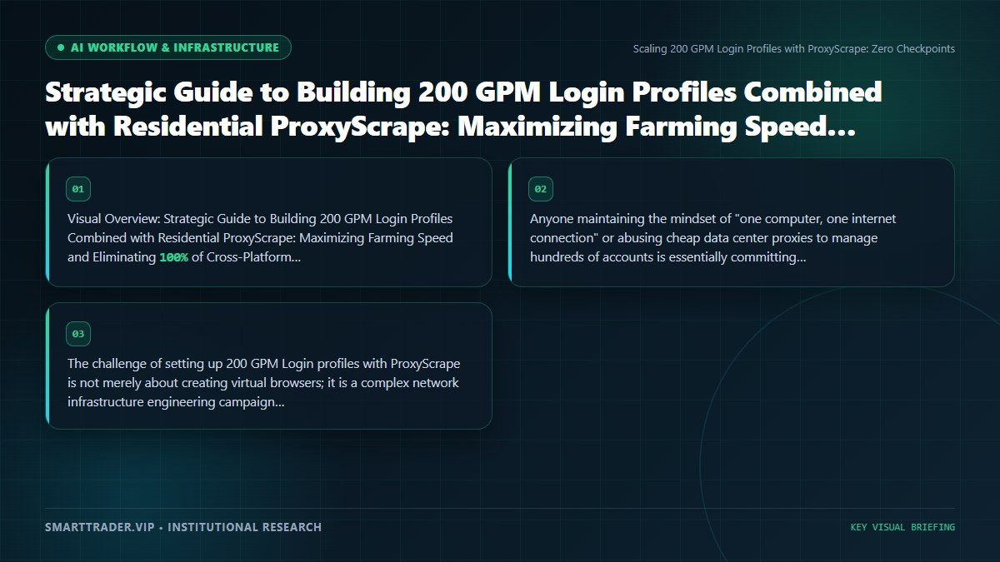
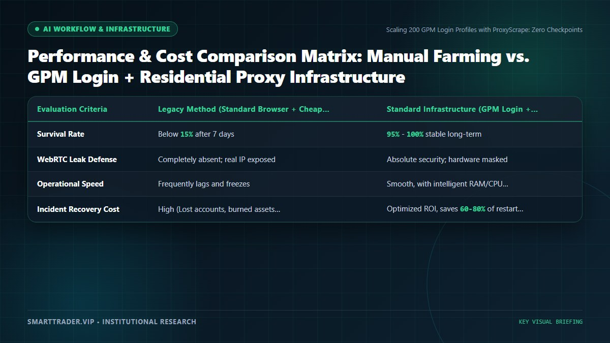

## Strategic Guide to Building 200 GPM Login Profiles Combined with Residential ProxyScrape: Maximizing Farming Speed and Eliminating 100% of Cross-Platform Checkpoints

*Visual Overview: Strategic Guide to Building 200 GPM Login Profiles Combined with Residential ProxyScrape: Maximizing Farming Speed and Eliminating 100% of Cross-Platform Checkpoints*

### The standard workflow for setting up an Antidetect Browser and clean residential proxy infrastructure, empowering Airdrop hunters and mass-account farmers to bypass all security screening walls.

The MMO (Make Money Online), Airdrop hunting, and Social Farming markets have entered a brutal era of filtration. Anyone maintaining the mindset of "one computer, one internet connection" or abusing cheap data center proxies to manage hundreds of accounts is essentially committing digital suicide. The challenge of **setting up 200 GPM Login profiles with ProxyScrape** is not merely about creating virtual browsers; it is a complex network infrastructure engineering campaign designed to outsmart the next-generation anti-fraud AI algorithms deployed by Facebook, Google, Twitter (X), Discord, and strict Web3 platforms.

---

## The Anatomy of Failure: Why Do 90% of MMO Operators Get Their Accounts Wiped?

The primary reason your account portfolio gets flagged and banned (checkpointed or mass-banned) after just 3 to 5 days of operation is not the content you post, but your **Digital Fingerprint** and **IP Footprint**.

### WebRTC Leaks and Hardware Parameter Duplication
When you use standard browsers or low-quality emulation tools, parameters such as Canvas, WebGL, AudioContext, ClientRects, and specifically **WebRTC IP Leaks** are fully exposed and readable by websites. If 10 accounts access a system sharing identical hardware and software parameters, the security engine will instantly flag them as a "botnet" or an "account farm" and ruthlessly eliminate them.

### The Pitfalls of Cheap Data Center Proxies
Most MMO operators gravitate toward random, cheap datacenter proxies due to rock-bottom pricing. However, the IP subnets of these datacenter providers have long been blacklisted by nearly all major platforms. Using a datacenter IP to farm accounts is equivalent to walking through a security checkpoint wearing a placard that reads, "I am a Bot."

To survive, you are required to build a professional infrastructure where **GPM Login** acts as an invisibility cloak concealing your hardware, paired with pristine **Residential ProxyScrape** proxies to disguise your physical location and network carrier.

---

## Comprehensive Solution: The Workflow for Setting Up 200 GPM Login Profiles with Residential ProxyScrape

To smoothly operate 200 profiles without lagging, freezing, or IP conflicts, follow this battle-tested standard workflow:

### Step 1: Preparing the Infrastructure Platform (Hardware & Software)
Before creating any profiles, your computer or VPS must possess sufficient horsepower to handle 200 background browser tabs (or running in rotation cycles).
*   **Recommended VPS/PC Configuration:** Minimum 8 Cores / 16 Threads CPU, 32GB RAM (allocating roughly 1.5GB per active tab cluster), and high-read/write NVMe SSD storage.
*   **Software:** Install the latest version of GPM Login to leverage deep fingerprint spoofing algorithms built directly into the Chromium core.

### Step 2: Sourcing and Allocating Clean Residential ProxyScrape Proxies
Utilize Residential ProxyScrape resources (rotating or static, depending on whether your objective is long-term farming or short-term account management):
*   **The Golden Rule:** 1 static proxy corresponds to 1 GPM Login profile (1:1 ratio). Absolutely never share a single IP across multiple sensitive accounts.
*   Match the IP Geo-location to the target language and time zone of the account you are cultivating (e.g., for US accounts, select US proxies from carriers like AT&T or Verizon).

### Step 3: Automating the Creation of 200 GPM Login Profiles
Instead of manually creating each profile—which is extremely time-consuming and prone to human error—utilize GPM Login's **Excel/CSV Profile Import** feature:
1.  Prepare a `.csv` file containing data fields: Profile Name, User-Agent, Proxy (formatted as `IP:Port:Username:Password`), Timezone, WebGL, Canvas, etc.
2.  Import directly into the GPM Login software.
3.  Configure automated mechanisms to cycle cookies and caches after every working session to emulate genuine human behavior.

> 💡 **Practical Note:** When executing mass setups, divide the 200 profiles into smaller cohorts (20–30 profiles per group) managed within distinct Folders inside GPM Login. This allows you to effortlessly monitor account statuses, preventing IP mix-ups or accidental broad-scale operations.

---

## Performance & Cost Comparison Matrix: Manual Farming vs. GPM Login + Residential Proxy Infrastructure

*Visual Overview: Performance & Cost Comparison Matrix: Manual Farming vs. GPM Login + Residential Proxy Infrastructure*

| Evaluation Criteria | Legacy Method (Standard Browser + Cheap Proxy) | Standard Infrastructure (GPM Login + Residential ProxyScrape) |
| :--- | :--- | :--- |
| **Survival Rate** | Below 15% after 7 days | **95% - 100% stable long-term** |
| **WebRTC Leak Defense** | Completely absent; real IP exposed | **Absolute security; hardware masked** |
| **Operational Speed** | Frequently lags and freezes | Smooth, with intelligent RAM/CPU optimization |
| **Incident Recovery Cost** | High (Lost accounts, burned assets, capital spent rebuilding) | **Optimized ROI, saves 60-80% of restart costs** |
| **Scale-up Capacity** | Limited; vulnerable to sweeping network bans | **Easily scalable to 500 - 1,000 profiles** |

---

## Operational Optimization and ROI Mathematics for MMO Operators

Investing in a clean infrastructure upfront may initially seem costly, but viewed through a long-term economic lens, it represents the highest-yielding investment available. When you own 200 high-quality, checkpoint-free accounts, you unlock the ability to:
1.  **Automate Airdrop Farming:** Capitalize on major token allocation cycles across Layer 1 and Layer 2 ecosystems without triggering sybil bot filters.
2.  **Operate Social Farming Systems:** Run interaction seeding, e-commerce scaling, and marketing campaigns without quantity restrictions.
3.  **Minimize Personnel Overhead:** Integrate GPM Login with Python/Selenium or n8n automation scripts to automate 90% of manual tasks.

However, sourcing legitimate licensed software, wholesale high-speed residential proxies, and optimized automation scripts consistently presents a major headache for newcomers. Understanding these pain points, our infrastructure ecosystem delivers an end-to-end solution designed to drive your operational costs down to absolute minimums.

---

## 🌐 Licensed AI Resources & Automated MMO Infrastructure Repository

A clean infrastructure paired with stable, licensed tools forms the foundational bedrock determining the success or failure of any MMO & Automation project:

- 🛒 **Comprehensive Repository of 84+ AI Tools & Wholesale MMO Software Licenses:** Explore the full lineup across 6 tool categories (Super AI, Coding Cloud, Creative Video/Voice, Clean VPNs & Digital Accounts) at [AI & MMO Infrastructure Repository (https://tintucnft.com)](https://smarttrader.vip/mmo-infrastructure).
- ⚡ **24/7 Automated Purchasing:** Receive accounts and software license keys instantly within 30 seconds via our Telegram bot: [Automated Purchase Bot (@chatgpsplusbot)](https://t.me/chatgpsplusbot).
- 🤖 **Myfxbook Bot EA Performance Verification:** Visit [MT5 EA Bots (https://tintucnft.com)](https://smarttrader.vip/automated-bot-trading) immediately to review verified track records featuring Max Drawdowns under 10%.
- 🎁 **Exclusive Lead Magnet Giveaway:** Claim a **Genuine GPM Login License (Free Key Included)** alongside a bundled library of **50+ AI Prompts & Automated Workflows**: [Message Admin (@willrich)](https://t.me/willrich).
- ✈️ **Daily Signal & Strategy Updates:** Join the [MCG Community Telegram Channel](https://t.me/channelmcg) right now to ensure you never miss critical market alerts.