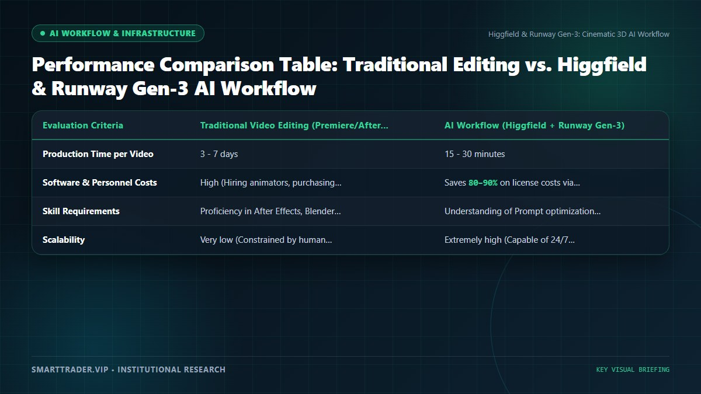

## Exploiting Higgfield Combined with Runway Gen-3: The 3D Cinematic Viral Video Production Workflow Without Video Editing Skills

*Modern AI video and digital asset generation workflows help optimize time and enhance content quality.*

*The ultimate secret combining cutting-edge AI image and motion tools, helping content creators slash 90% of their video editing time.*

Are you spending weeks refining every single frame in Premiere or After Effects, only for your videos to remain dull and unable to keep up with visual trends? Meanwhile, TikTok, Reels, and YouTube Shorts channels focusing on finance, crypto, or MMO products constantly pump out 3D cinematic videos hitting millions of views using just a few text prompts. The reality is that traditional video editing is obsolete. If you do not know how to **exploit Higgfield combined with Runway Gen-3**, you are leaving yourself behind in the speed race of the AI Video era.

---

## The Core Problem: Why Do MMOers and Content Creators Burn Out Over 3D Videos?

In the modern world of MMO and content creation, video is the "ultimate weapon" for conversion and traffic acquisition. However, to produce high-quality cinematic 3D videos, production teams typically face three fatal bottlenecks:

1. **Prohibitively Expensive 3D Modeling Costs:** Hiring Blender or Cinema 4D personnel is costly, and completing a single project takes anywhere from 5 to 7 days.
2. **Render Performance Chokes Hardware:** Running 3D rendering on personal computers or weak VPS setups leads to crashes, lag, wasted electricity, and endless waiting times.
3. **Lack of Agility:** As platform algorithms shift constantly, content must adapt hourly. Old-school editing cannot keep pace with the "speed of light" of market trends.

To solve this equation, technical system operators and MMO "whales" waste no time learning professional video editing. Instead, they build automation pipelines by **exploiting Higgfield combined with Runway Gen-3**—the ultimate AI duo for generating deep 3D visuals and ultra-smooth cinematic motion today.

---

## Solution & Technical Workflow: Exploiting Higgfield Combined with Runway Gen-3 From A to Z

To optimize resource performance and costs, the 3D cinematic video production workflow—bypassing traditional modeling—is executed through the following battle-tested steps:

### Step 1: Ideation & Base Image Generation on Higgfield AI

Higgfield is a state-of-the-art tool for creating deep 3D characters and spaces, perfectly suited for sci-fi, crypto, cyberpunk, or cinematic portrait concepts.

* **Infrastructure Access:** Access clean licensed accounts via Antidetect Browsers (such as GPM Login) combined with clean residential proxies to protect sessions and prevent arbitrary checkpoints from AI systems.
* **Prompt Engineering:** Write detailed prompt descriptions in English (or optimize them via ChatGPT Plus). For example: *"A cyberpunk trader looking at holographic charts in a futuristic skyscraper, 3d render, cinematic lighting, unreal engine 5, 8k resolution"*
* **File Export:** Take the perfectly composed 3D image as the input (Image-to-Video) for the next step.

### Step 2: Infusing Cinematic Motion with Runway Gen-3 Alpha

Once you have a high-quality base image from Higgfield, transition to the physical motion generation phase. **Runway Gen-3** is the current gold standard for smoothness, understanding of physical context, and camera control precision.

* **Import Image:** Upload the image generated from Higgfield onto the Runway platform.
* **Camera Control Setup:** Configure camera angles (Pan, Zoom, Roll) to establish professional cinematic effects.
* **Motion Brush / Prompt Motion:** Isolate details requiring movement (such as data streams flowing across screens, character breathing, blinking neon lights) and input motion prompts.
* **Render & Download:** Runway’s cloud infrastructure processes and delivers high-definition video in just a few minutes.

### Step 3: Automated Post-Production via Integrated Workflows

With hundreds of accounts needed to mass-produce videos for MMO campaigns, manual operation is impossible. Infrastructure engineers typically integrate the APIs of these tools into automation systems like n8n or Python scripts:

* Automatically fetch prompts from Google Sheets.
* Send image generation requests to Higgfield, then push outputs to Runway Gen-3.
* Automatically download videos to the VPS, inject copyrighted audio from AI music libraries, and push them straight to social media platforms.

> 💡 **Practical Note:** When managing fleets of creative AI accounts (Runway, Higgfield, Midjourney), never share a single IP address or standard browser profile. Use an Antidetect Browser like GPM Login combined with clean residential proxies to keep accounts at peak trust status, preventing IP bans that wipe out your loaded credits.

---

## Performance Comparison Table: Traditional Editing vs. Higgfield & Runway Gen-3 AI Workflow

*Visual Summary: Performance Comparison Table: Traditional Editing vs. Higgfield & Runway Gen-3 AI Workflow*

| Evaluation Criteria | Traditional Video Editing (Premiere/After Effects) | AI Workflow (Higgfield + Runway Gen-3) |
| :--- | :--- | :--- |
| **Production Time per Video** | 3 - 7 days | 15 - 30 minutes |
| **Software & Personnel Costs** | High (Hiring animators, purchasing expensive licensed plugins) | Saves 80–90% on license costs via wholesale resource pools |
| **Skill Requirements** | Proficiency in After Effects, Blender, Premiere | Understanding of Prompt optimization and workflow management |
| **Scalability** | Very low (Constrained by human resources and time) | Extremely high (Capable of 24/7 automation via API) |
| **Visual Trend Responsiveness** | Slow (Time-consuming to build models from scratch) | Instantaneous (Trends adapted within minutes) |

---

## Optimizing AI Account Licensing Costs & MMO Infrastructure

Possessing powerful tools is not enough; economic return (ROI) is what dictates whether you survive in the MMO industry. Purchasing individual Runway Gen-3 or Higgfield accounts at retail prices will quickly erode your profit margins. 

The optimal solution applied by infrastructure experts is leveraging the **Warehouse of 84+ Wholesale Licensed AI & MMO Tools**. Instead of spending thousands of dollars on Enterprise tiers, you gain access to the entire ecosystem of Super AI, Coding Cloud, and Creative Video/Voice tools (including accounts for Runway, Higgfield, ElevenLabs, Midjourney...) at optimized costs, saving 60–80%.

---

## 🌐 AI License Resource & Automated MMO Infrastructure Hub

Clean infrastructure and stable licensed tools are the foundations determining the success or failure of any MMO & Automation project:

- 🛒 **Master Warehouse of 84+ Wholesale AI & MMO Licenses:** Explore the full collection of 6 tool categories (Super AI, Coding Cloud, Creative Video/Voice, Clean VPNs & Digital Accounts) at [MMO Infrastructure Hub](https://smarttrader.vip/mmo-infrastructure).
- ⚡ **24/7 Automated Purchasing:** Instant delivery of licensed accounts/keys within 30 seconds via Telegram Bot: [Automated Purchasing Bot (@chatgpsplusbot)](https://t.me/chatgpsplusbot).
- 🤖 **Verify Myfxbook EA Bot Performance:** Access [MT5 EA Bots](https://smarttrader.vip/automated-bot-trading) immediately to review verified track records with Max Drawdown under 10%.
- 🎁 **Exclusive Lead Magnet Gift:** Claim a **Genuine GPM Login License (Free Key Included)** along with a bundle of **50+ AI Prompts & Automation Workflows**: [Contact Admin (@willrichus)](https://t.me/willrichus).
- ✈️ **Daily Signals & Strategy Updates:** Join the [MCG Community Telegram Channel](https://t.me/channelmcg) right now to ensure you never miss critical market alerts.