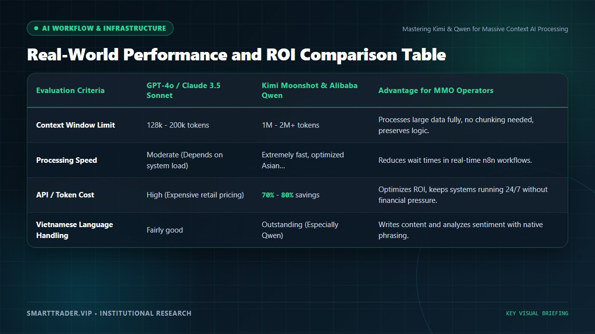

## Exploiting Kimi Moonshot and Alibaba Qwen: The Ultimate Secret to Optimizing Large Data Context Processing Speed for MMO Operators

*Close-up of an accuracy testing tool, symbolizing the optimization of big data processing speed.*

In the world of modern **MMO (Make Money Online)** and automation, the greatest resource is not just capital, but **data processing speed** and **operational efficiency**. When you are scraping millions of rows of data from e-commerce platforms, analyzing thousands of pages of crypto whitepapers, or managing a system of hundreds of automated accounts using **n8n combined with Antidetect Browsers (GPM Login)**, relying on expensive AI models like GPT-4 or Claude 3.5 Sonnet with their tiny context limits will quickly back you into a financial dead end.

It is time for professional earners to pivot to heavy-duty artillery: **Kimi Moonshot** and **Qwen (Alibaba)**. This duo is completely transforming the large-context exploitation landscape with 70-80% lower costs while delivering processing performance that is second to none.

---

## The Core Problem: Why Do MMO Operators Often Burn Their Pockets When Processing Big Data?

Most practitioners engaged in automation systems, mass content seeding, or financial market sentiment analysis typically run into three fatal technical walls:

1. **Context Window Limitations Are Too Small:** Traditional models typically choke inputs at a few tens of thousands of tokens. When you dump a massive raw data set into them, the system is forced into chunking, leading to context loss and causing the AI to make "clueless" decisions that ruin the entire automation script.
2. **API Token Costs Skyrocket:** Running an **n8n** script that continuously calls APIs 24/7 to analyze competitor data, write bulk SEO content, or optimize Python code for MMO tools will consume massive fees if you use Tier 1 models from OpenAI or Anthropic. Your ROI is choked before the system even has a chance to turn a profit.
3. **Checkpoints and Mass Account Bans:** Processing big data without routing traffic through **clean residential proxies** combined with **Antidetect Browsers (GPM Login)** will allow platform scanning algorithms to detect API footprints, instantly wiping out clones that took painstaking effort to build.

> 💡 **Practical Note:** Never use personal API keys bought directly at retail prices for large-scale automation tasks. Optimizing infrastructure costs through enterprise-grade copyright resource sharing packages from **[MMO Infrastructure & AI Hub](https://smarttrader.vip/mmo-infrastructure)** is the ultimate survival problem for any true **Smart Trader**.

---

## The Breakthrough Solution: Power From Kimi Moonshot and Alibaba Qwen

The emergence of **Kimi Moonshot** (with its ability to smoothly process millions of context tokens) and **Qwen** from the Alibaba group (offering stellar optimization for Asian languages and robust coding capabilities) has decisively solved the aforementioned challenges.

### 1. Kimi Moonshot: The "Monster" for Massive Raw Data Contexts
Kimi is famous for its ability to read an entire large code repository, a thousand-page book, or the complete chat history of thousands of customers in a single API call.
* **MMO Application:** Load entire marketing campaign data, on-chain transaction histories, or thousands of competitor articles into Kimi to discover the most optimized content angles without risking a loss of logical flow.

### 2. Alibaba Qwen: Optimizing Python Code, Automation, and Processing Speed
Qwen is not only strong in context handling but also extremely sharp at writing **Python** scripts, optimizing automated workflow structures on **n8n**, and solving complex logical problems at lightning-fast speeds.
* **MMO Application:** Automatically generate data extraction code (scrapers), write automated engagement bots, and optimize **Cloud VPS** infrastructure systems without wasting time on debugging.

---

## Real-World Performance and ROI Comparison Table

*Visual Summary: Real-World Performance and ROI Comparison Table*

To clearly understand why professional MMO circles are shifting cash flow toward Kimi and Qwen, let's examine the technical breakdown below:

| Evaluation Criteria | GPT-4o / Claude 3.5 Sonnet | Kimi Moonshot & Alibaba Qwen | Advantage for MMO Operators |
| :--- | :--- | :--- | :--- |
| **Context Window Limit** | 128k - 200k tokens | 1M - 2M+ tokens | Processes large data fully, no chunking needed, preserves logic. |
| **Processing Speed** | Moderate (Depends on system load) | Extremely fast, optimized Asian infrastructure | Reduces wait times in real-time **n8n** workflows. |
| **API / Token Cost** | High (Expensive retail pricing) | 70% - 80% savings | Optimizes **ROI**, keeps systems running 24/7 without financial pressure. |
| **Vietnamese Language Handling** | Fairly good | Outstanding (Especially Qwen) | Writes content and analyzes sentiment with native phrasing. |
| **Integration Stability** | Prone to rate limits under bursts | High stability, easy to scale up | Runs hundreds of automation threads smoothly with minimal interruptions. |

---

## Automation System Deployment Workflow With Kimi & Qwen

To fully exploit the power of this duo in MMO campaigns, you need to set up a robust infrastructure architecture following these steps:

### Step 1: Prepare Clean Infrastructure
* Rent high-configuration **Cloud VPS** nodes located close to Asia to minimize latency when calling APIs.
* Use an **Antidetect Browser (GPM Login)** combined with **clean residential proxies** to isolate the working environment for each account, preventing device flags.

### Step 2: Build Automation Workflows via n8n or Python
* Set up nodes in **n8n** to automatically scrape data from various sources (Telegram, Twitter, exchange web portals, etc.) and consolidate them into large data files.
* Call the Kimi Moonshot API to analyze the entire massive dataset in a single run (leveraging the massive context window).
* Pass the results to Qwen to generate subsequent Python code snippets or automated action scripts.

### Step 3: Operation and Scale-Up
* Deploy finalized scripts to run automatically 24/7.
* Monitor performance through centralized management tools and optimize API costs using wholesale licensed accounts from reputable distribution systems.

---

## 🌐 AI Copyright Resources & Automated MMO Infrastructure Hub

Clean infrastructure and stable licensed tools form the foundation that determines the success or failure of all MMO & Automation projects:

- 🛒 **Total Hub of 84+ AI Tools & Wholesale MMO Licenses:** Explore the full set of 6 tool categories (Super AI, Cloud Coding, Creative Video/Voice, Clean VPN & Digital Accounts) at [MMO Infrastructure & AI Hub](https://smarttrader.vip/mmo-infrastructure).
- ⚡ **24/7 Automated Purchasing:** Transact and receive accounts/license keys instantly in 30 seconds via the Telegram bot: [Automated Purchase Bot (@chatgpsplusbot)](https://t.me/chatgpsplusbot).
- 🤖 **Myfxbook EA Bot Performance Verification:** Access [MT5 EA Bot](https://smarttrader.vip/automated-bot-trading) immediately to view real track records with a Max Drawdown under 10%.
- 🎁 **Exclusive Lead Magnet Gifts:** Receive a **genuine GPM Login License (Free Key Gift)** along with a set of **50+ AI Prompts & Workflows** for automation: [Message Admin (@willrich)](https://t.me/willrich).
- ✈️ **Daily Signals & Strategy Updates:** Join the [MCG Community Telegram Channel](https://t.me/channelmcg) right now so you never miss critical market alerts.