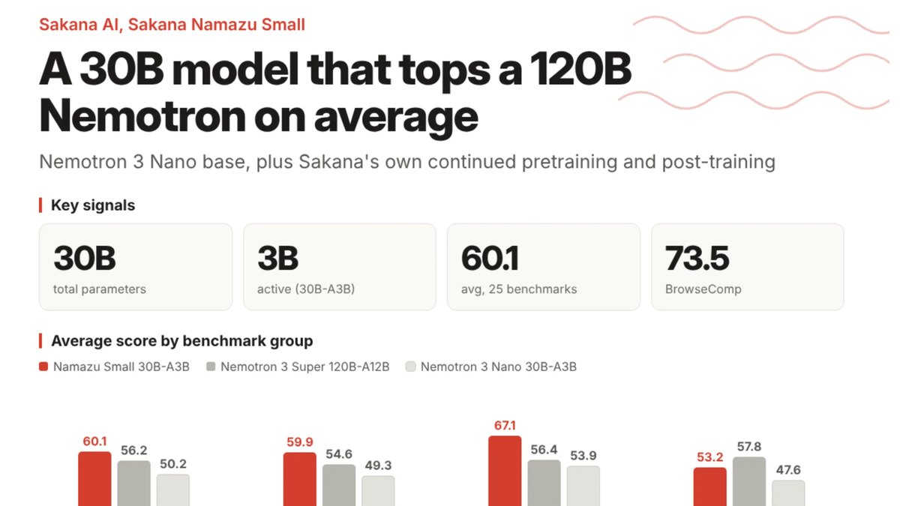
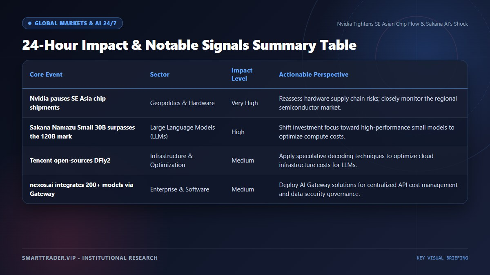

Today, the global financial and technology markets are witnessing profound geopolitical turning points alongside deep technical breakthroughs. As Washington continues to tighten its web of technology controls over Beijing, hardware supply chains in Asia are forced to reposition. Simultaneously, the pace of optimizing large language model (LLM) infrastructure and AI Gateway platforms is accelerating at a breakneck speed, reshaping the global competitive order from Silicon Valley to Asia.

## AI Breakthroughs & New Model Infrastructure

*Performance chart comparing the technical parameters of the Sakana Namazu Small model with market competitors. (Source: MarkTechPost)*

- **Sakana AI Releases Namazu Small, a 30B Model Built on Nemotron 3 Nano**: Sakana AI has officially released **Sakana Namazu Small**, a **30B-A3B** scale reasoning model built on the **NVIDIA Nemotron 3 Nano** framework. Remarkably, this model achieves an average score of **60.1 across 25 standard benchmarks**, outperforming even its predecessor, the **120B Nemotron 3 Super**, which stalls at **56.2**. This achievement proves that small language models are fully capable of delivering superior performance through intelligent architectures and optimized training strategies, ushering in an era of significantly reduced operational costs for enterprises adopting AI. [Sakana AI Releases Namazu Small](https://www.marktechpost.com/2026/11/26/sakana-ai-namazu-small-30b-nemotron-3-nano/)

- **Tencent Open-Sources DFly2: Speculative Decoding That Reuses the Target’s Sparse KV Cache**: **Tencent** has open-sourced **DFly2**, a speculative decoding drafter designed specifically for sparse-attention LLMs. By allowing each draft layer to reuse the target model's **KV cache** and **top-k indexer**, DFly2 incurs zero additional draft KV memory overhead and pushes serving throughput for long **64K** contexts to impressive levels. This is a critical infrastructure piece helping cloud service providers drastically cut hardware costs when serving massive concurrent user bases. [Tencent Open-Sources DFly2](https://www.marktechpost.com/2026/11/26/tencent-dfly2-speculative-decoding-sparse-models/)

- **nexos.ai AI Adoption Platform puts 200+ models behind one AI Gateway**: The **nexos.ai** platform has launched an integrated solution hosting more than **200+ AI models** behind a single **AI Gateway**, complete with built-in budget capping and governance systems. This solution directly resolves a major headache for enterprise CIOs regarding API cost management, security risk control, and seamless switching between model providers without rewriting source code. [nexos.ai AI Adoption Platform](https://www.marktechpost.com/2026/11/26/nexos-ai-ai-gateway-200-models-governance/)

## Market Movements, Regulations & Macroeconomics

- **Nvidia hits pause on chip shipments to Southeast Asia**: **Nvidia** has officially requested manufacturing partners to temporarily halt shipments of server racks containing high-end AI chips to **Malaysia, Singapore, Thailand, and Indonesia**. This move comes as the **U.S.** government further tightens export control measures to close any loopholes that could allow advanced AI chips to reach China via third parties. This decision not only creates a short-term shock for Southeast Asian data centers but also forces investors to reassess Nvidia's profit margins and supply chain risks in the region. [TechCrunch AI](https://techcrunch.com/2026/11/26/nvidia-hits-pause-on-chip-shipments-to-southeast-asia/)

## 24-Hour Impact & Notable Signals Summary Table

*Visual summary: 24-Hour Impact & Notable Signals Summary Table*

| Core Event | Sector | Impact Level | Actionable Perspective |
| :--- | :--- | :--- | :--- |
| **Nvidia pauses SE Asia chip shipments** | Geopolitics & Hardware | **Very High** | Reassess hardware supply chain risks; closely monitor the regional semiconductor market. |
| **Sakana Namazu Small 30B surpasses the 120B mark** | Large Language Models (LLMs) | **High** | Shift investment focus toward high-performance small models to optimize compute costs. |
| **Tencent open-sources DFly2** | Infrastructure & Optimization | **Medium** | Apply speculative decoding techniques to optimize cloud infrastructure costs for LLMs. |
| **nexos.ai integrates 200+ models via Gateway** | Enterprise & Software | **Medium** | Deploy AI Gateway solutions for centralized API cost management and data security governance. |

## 60-Second Quick Read
- **Nvidia** has temporarily frozen server shipments containing AI chips destined for Malaysia, Singapore, Thailand, and Indonesia to comply with strict new U.S. regulations.
- **Sakana AI** delivered a major surprise as its 30B Namazu Small model defeated the 120B Nemotron 3 Super version on standard benchmark tests.
- **Tencent** optimized 64K context performance via open-source DFly2, resolving the KV cache memory consumption bottleneck in LLMs.
- **nexos.ai** launched a unified management platform enabling enterprises to access over 200+ AI models with real-time budget controls.

---
## 🎯 Exclusive Portals & Trading Tools
- ⚡ **Real-time Live Signal Framework:** [Trading Signal VIP](https://smarttrader.vip/vip-trading-signals)
- 🤖 **Myfxbook EA Bot Performance Verification:** Access [Automated Bot Trading](https://smarttrader.vip/automated-bot-trading) immediately to view audited track records with a Max Drawdown under 10%.
- 🌐 **Automation Infrastructure:** [MMO Infrastructure](https://smarttrader.vip/mmo-infrastructure)
- ✈️ **Receive Daily Newsletters:** Join the [MCG Community Telegram Channel](https://t.me/channelmcg) now.