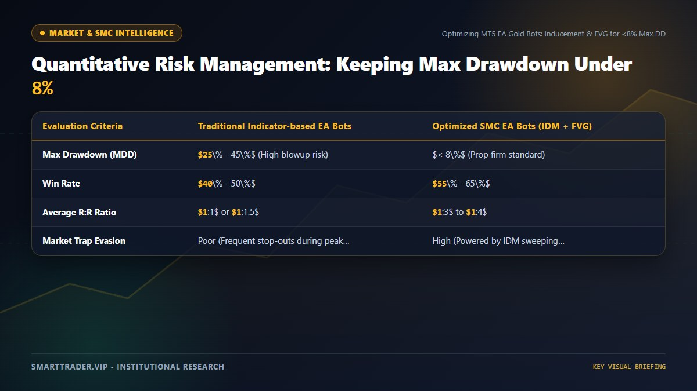

## Optimizing MT5 EA Bots for XAUUSD Gold Trading: Combining Inducement and Fair Value Gap to Keep Max Drawdown Under 8%

*The architecture of a classical financial building symbolizing institutional order and market structures.*

*Algorithmic programming solutions and quantitative risk management designed to help automated bots evade institutional market traps.*

---

The Gold market ($XAUUSD$) has never been a straightforward endeavor for automated traders. Most investors, when first deploying algorithms on the MetaTrader 5 platform, harbor dreams of quick wealth driven by the precious metal's high volatility. However, the harsh paradox of quantitative finance reveals that **90% of MT5 EA bots on XAUUSD self-destruct after just a few weeks of live trading**. The root cause lies not in VPS execution speed or network latency, but in a fatal flaw within the mathematical model: the bot lacks the capability to recognize the footprints of "Smart Money."

When your algorithm relies solely on traditional technical indicators such as RSI, MACD, or Moving Averages, it acts merely as a lamb entering a forest rife with market maker price traps. This article dissects the quantitative architecture required to **optimize the XAUUSD Inducement MT5 EA bot**, combining it with the Fair Value Gap ($FVG$) to strictly control Max Drawdown below $8\%$—the gold standard for passing evaluations at leading proprietary trading firms.

---

## 1. The Anatomy of Failure in Traditional XAUUSD EA Bots

### The Paradox Between Flawless Backtests and Disastrous Live Trading
A classic phenomenon in the quant trading community is "Overfitting." You optimize an EA bot on 5 years of historical $XAUUSD$ data and achieve a Profit Factor of up to $2.5$ with a win rate touching $75\%$. Yet, the moment you switch to Live Trading on a real account, a single New York session during Non-Farm Payrolls (NFP) data erodes $30\%$ of the account, hitting the broker's stop-out threshold.

### Why Conventional EA Bots Fall Into Inducement (IDM) Traps
Financial markets operate as a zero-sum game, where big money requires liquidity to fill massive position sizes. **Inducement (IDM)** serves as the ultimate trap designed to trigger retail breakout orders or stop losses. 

Standard EA bots are programmed with linear logic: *"Price breaks resistance -> Buy"* or *"Price breaks support -> Sell."* Right at this juncture, Smart Money pushes price past a minor high/low (Inducement) to sweep liquidity before executing a sharp reversal. An EA bot lacking an integrated IDM recognition algorithm will repeatedly run into market crossfire, triggering consecutive losses that bloat the Max Drawdown far beyond the $10\%$ limit.

---

## 2. Quantitative Solutions: Integrating SMC into Mql5 Source Code

To build an institutional-grade automated trading system at **Smart Trader VIP**, we cannot swim against the current of Smart Money; instead, we must program our algorithms to **move in sync with institutional players**.

### The Mql5 Inducement (IDM) Recognition Algorithm
Inducements typically materialize right before an Order Block ($OB$) or a Fair Value Gap ($FVG$). Within the EA's Mql5 source code structure, we must build a Market Structure Shift (MSS) scanning function combined with liquidity sweeps:

1. **Identify CHoCH (Change of Character):** Upon a trend shift, the bot records a valid market structure break.
2. **Filter the IDM Zone:** The initial pullback zone following the formation of a new structure is defined as IDM. The bot is strictly prohibited from placing buy/sell orders in breakout zones that have not cleared this IDM.
3. **Await Liquidity Sweeps:** Only when price sweeps the IDM point and taps into a refined **Fair Value Gap ($FVG$)** zone will a trade be triggered via the `OrderSend()` function.

### The Synergistic Power of Inducement and Fair Value Gap (FVG)
*Fair Value Gaps* represent price voids characterized by severe supply and demand imbalances left behind by institutional block orders. When price sweeps through an IDM, it typically retraces to fill these $F_VGs$. The fusion of **Inducement and FVG** creates a high-probability filtering mechanism:
* **IDM:** Eliminates noisy entry points and defends against fakeouts.
* **FVG:** Delivers an optimal Risk-to-Reward (R:R) entry point, typically ranging from $1:3$ to $1:5$.

---

## 3. Quantitative Risk Management: Keeping Max Drawdown Under 8%

*Visual summary: 3. Quantitative Risk Management: Keeping Max Drawdown Under 8%*

No matter how optimized an SMC strategy may be, it becomes meaningless under loose capital management. To operate an EA bot on $XAUUSD$ with absolute safety, the principles of compounding and risk allocation must be addressed mathematically.

### Performance Comparison Table: Traditional Bots vs. Institutional SMC Bots (XAUUSD)

| Evaluation Criteria | Traditional Indicator-based EA Bots | Optimized SMC EA Bots (IDM + FVG) |
| :--- | :--- | :--- |
| **Max Drawdown (MDD)** | $25\% - 45\%$ (High blowup risk) | **$< 8\%$ (Prop firm standard)** |
| **Win Rate** | $40\% - 50\%$ | $55\% - 65\%$ |
| **Average R:R Ratio** | $1:1$ or $1:1.5$ | **$1:3$ to $1:4$** |
| **Market Trap Evasion** | Poor (Frequent stop-outs during peak hours) | **High (Powered by IDM sweeping algorithms)** |
| **Capital Management** | Martingale or arbitrary fixed lot sizes | **Kelly Criterion combined with Dynamic Lots** |

### Modified Kelly Criterion Risk Allocation Formula
To cap Max Drawdown below $8\%$, never use fixed lot sizes that ignore account balances. In our MT5 EA source code, order size ($LotSize$) is dynamically computed based on the Average True Range (ATR) volatility of $XAUUSD$ and the current balance:

$$\text{Risk Amount} = \text{Balance} \times 0.007 \quad (\text{Maximum risk of } 0.7\% \text{ per trade})$$

$$\text{Lot Size} = \frac{\text{Risk Amount}}{\text{Distance (Points)} \times \text{Tick Value}}$$

This methodology enables the bot to automatically scale down trading volume when $XAUUSD$ experiences extreme volatility, completely eliminating cascading blowout risks during major news releases.

---

جو **Practical Note:** When running MT5 EA bots on the $XAUUSD$ gold pair, never set arbitrarily wide stop losses or operate without a stop loss (No-SL). Always configure your automated exit functions based on Candle Close Stop Losses rather than wick shadows, and completely disable the bot during high-impact red-folder news events (CPI, FOMC, NFP) to protect your equity curve.

---

## 4. Conclusion

Conquering the $XAUUSD$ currency pair through algorithmic trading is no longer an exclusive privilege of large hedge funds once you master quantitative principles. By integrating **Inducement** recognition algorithms alongside **Fair Value Gap** anchor points, your MT5 EA bot transforms from a cash-burning machine into an emotionless profit printer that strictly holds Max Drawdown within a safe threshold below $8\%$.

---

## 🎯 Cash Flow Automation & Risk Management Solutions

Financial markets fluctuate 24/5, and ironclad discipline is vital for survival:

- 🤖 **Verify Myfxbook EA Bot Performance:** Access [MT5 EA Bot](https://smarttrader.vip/automated-bot-trading) now to view live track records featuring a Max Drawdown under 10%.
- 🎁 **Experience a 1-Week Free Trial:** Receive optimized configuration files and server VPS setup support via [Technical Support Admin (@willrich)](https://t.me/willrich).
- ✈️ **Get Daily Signals & Strategies:** Join the [MCG Community Telegram Channel](https://t.me/channelmcg) to ensure you never miss urgent market warnings.