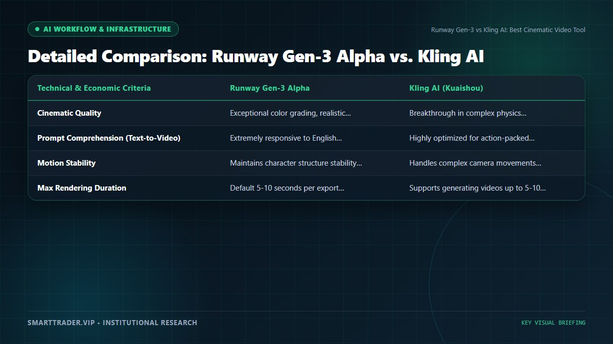

## Runway Gen-3 Alpha vs. Kling AI Comparison: Which is the Ultimate Cinematic AI Video Assistant for MMO Marketers?

*A smartphone displaying an AI video generation interface placed next to a pile of coins, symbolizing the opportunity to monetize digital content.*

*A detailed analysis of motion quality, resolution, and rendering costs between the two leading AI video generation powerhouses.*

---

The short-form video market, TikTok/Reels, and Affiliate Marketing campaigns are entering a brutal phase. Audiences have grown fatigued with bland videos cobbled together from free stock footage. To hook viewers in under 3 seconds, **cinematic** content featuring breathtaking visuals and smooth motion is a mandatory weapon. However, MMO (Make Money Online) creators frequently face a paradox: AI-generated videos often suffer from stuttering, body structure distortion (especially hands and faces) after a few seconds of rendering, high trial costs, and hours spent on manual prompt refinement. 

Faced with two monumental tools—**Runway Gen-3 Alpha** and **Kling AI**—choosing the wrong tool means burning money on rendering infrastructure and wasting account bandwidth. As an AI infrastructure and MMO automation architect at Smart Trader VIP & Tin Tức NFT, I will dissect the technical nature, costs, and real-world performance of these two powerhouses to help you thoroughly optimize your ROI.

---

## Technical Fundamentals: Why Do AI Videos Frequently Glitch and Cost a Fortune?

Most MMO creators fail at mass video production not due to a lack of ideas, but due to a failure to control **physical consistency** and **account operational costs**.

### 1. The Physics and Motion Challenge in AI Video
Older generation models typically process images as independent frames (frame-by-frame generation), leading to object morphing, loss of detail, or motion defying physical laws from the 3rd second onward. When running MMO campaigns that require producing hundreds of videos daily to flood social platforms, structurally flawed videos drag down engagement rates and cause conversion rates (CR) to plummet.

### 2. The Financial Burden of Standalone Licensed Accounts
Purchasing Runway or Kling Enterprise accounts directly at retail prices will crush your profit margins. To nurture a system of dozens of social channels, you cannot rely solely on a few limited free rendering quotas. The core challenge is to optimize infrastructure, utilizing wholesale-priced licensed accounts combined with automation tools to scale up production pipelines.

---

## Detailed Comparison: Runway Gen-3 Alpha vs. Kling AI

*Visual summary: Detailed Comparison: Runway Gen-3 Alpha vs. Kling AI*

To make a precise investment decision for your MMO infrastructure, let's put **Runway Gen-3 vs. Kling AI** on the technical and financial scale.

| Technical & Economic Criteria | Runway Gen-3 Alpha | Kling AI (Kuaishou) |
| :--- | :--- | :--- |
| **Cinematic Quality** | Exceptional color grading, realistic lighting, skin detail, and Hollywood aesthetic. | Breakthrough in complex physics simulations (water, smoke, fabrics, collisions). |
| **Prompt Comprehension (Text-to-Video)** | Extremely responsive to English prompts, deep understanding of professional cinematography terminology. | Highly optimized for action-packed scenes and fast-paced movements. |
| **Motion Stability** | Maintains character structure stability for the first 7-10 seconds, minimal body distortion. | Handles complex camera movements (panning, zooming) much more smoothly. |
| **Max Rendering Duration** | Default 5-10 seconds per export (extendable via the extend feature). | Supports generating videos up to 5-10 seconds long with high resolution and solid frame rates. |
| **License Cost & Credits** | High cost if purchased individually via the homepage, consumes heavy credits for high-end options. | More optimized credit costs when sourced through wholesale infrastructure providers. |

### Real-World MMO Evaluation:
*   **Runway Gen-3 Alpha** is the number one choice if your MMO niche involves storytelling content, high-end product reviews, visual arts, or aesthetically driven commercial films. Gen-3's control over lighting and composition is truly superior.
*   **Kling AI** is a "beast" when you need to produce videos featuring high-octane action, complex camera movements, and realistic physics simulations without breaking images or shifting frames.

---

## Infrastructure Optimization & 60-80% Cost Reduction Solutions

To operate a large-scale automated AI video production system without burning your accounts, you need to deploy a comprehensive infrastructure strategy:

### 1. Workflow Synchronization via Antidetect Browsers and Proxies
When managing a mass system of Runway or Kling accounts to claim free credits or manage licensed accounts, never log in directly via your personal browser. Use an **Antidetect Browser (such as GPM Login)** combined with **clean residential proxies** to isolate your browser fingerprint, preventing checkpoints or mass account bans.

### 2. Workflow Automation with Python and n8n
Instead of handling every video manually, build automation workflows via n8n or Python scripts integrated with AI tool APIs. Automating prompt input, downloading videos to a VPS, editing automatically via CapCut, and publishing to social platforms will save your team 90% of their time.

> 💡 **Practical Note:** When rendering heavy AI videos like Gen-3 or Kling, execute them on a Cloud VPS server with powerful GPU specifications or connect directly via stable licensed APIs. Utilizing wholesale account sources from reputable systems will cut your initial investment costs by 60–80% compared to purchasing retail directly from the publisher.

---

## Conclusion

Both **Runway Gen-3 Alpha** and **Kling AI** are formidable money-making engines if you know how to leverage their respective strengths for your MMO niche. Combining top-tier AI image quality with optimized account infrastructure is the key to dominating short-form video platforms and breaking through revenue barriers in the digital era.

---

## 🌐 AI License & Automated MMO Infrastructure Resource Hub

Clean infrastructure and stable licensed tools are the foundational drivers of success for any MMO & Automation project:

- 🛒 **Comprehensive Catalog of 84+ AI Tools & Wholesale MMO Licenses:** Explore the full set of 6 tool categories (Super AI, Coding Cloud, Creative Video/Voice, Clean VPNs, and Digital Accounts) at [MMO AI & Infrastructure Hub (smarttrader.vip)](https://smarttrader.vip/mmo-infrastructure).
- ⚡ **Automated 24/7 Purchasing:** Transact and receive licensed accounts/keys at lightning speed within 30 seconds via Telegram bot: [Automated Purchase Bot (@chatgpsplusbot)](https://t.me/chatgpsplusbot).
- 🤖 **Myfxbook Bot EA Performance Verification:** Access [MT5 EA Bot (smarttrader.vip)](https://smarttrader.vip/automated-bot-trading) immediately to view real-world track records with a Max Drawdown under 10%.
- 🎁 **Exclusive Gift (Lead Magnet):** Claim a **Genuine GPM Login License (Free Key Gifted)** alongside a bundle of **50+ AI Prompts & Automated Workflows**: [Message Admin (@willrich)](https://t.me/willrich).
- ✈️ **Daily Signal & Strategy Updates:** Join the [MCG Community Telegram Channel](https://t.me/channelmcg) right now so you never miss urgent market alerts.