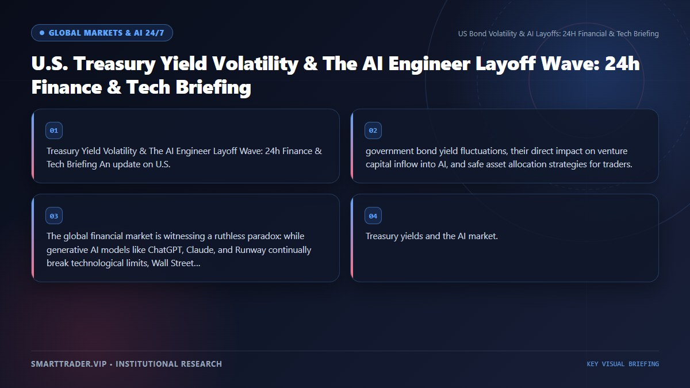
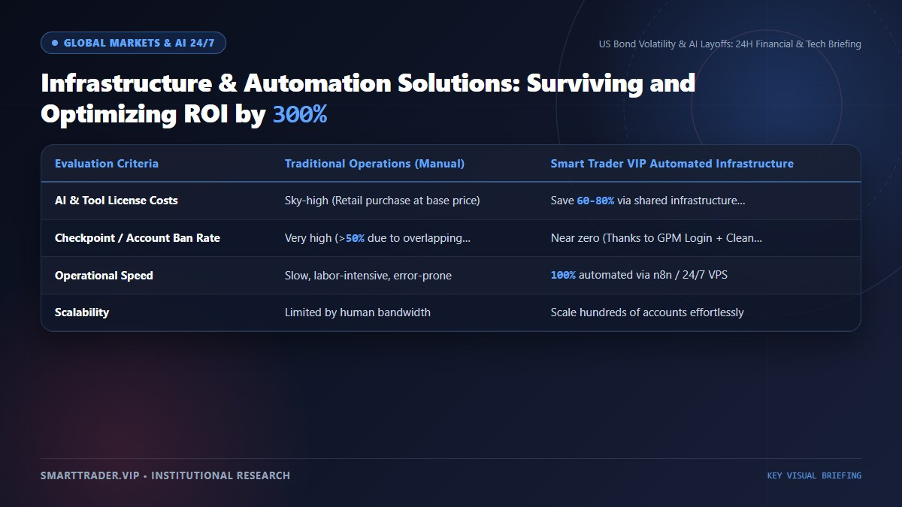

## U.S. Treasury Yield Volatility & The AI Engineer Layoff Wave: 24h Finance & Tech Briefing

*Visual summary: U.S. Treasury Yield Volatility & The AI Engineer Layoff Wave: 24h Finance & Tech Briefing*

An update on U.S. government bond yield fluctuations, their direct impact on venture capital inflow into AI, and safe asset allocation strategies for traders.

The global financial market is witnessing a ruthless paradox: while generative AI models like ChatGPT, Claude, and Runway continually break technological limits, Wall Street is trembling under historical volatility in **U.S. Treasury yields and the AI market**. Numerous venture capital (VC) funds are tightening their purse strings, triggering a massive wave of layoffs for AI engineers in Silicon Valley. 

From the perspective of a technology infrastructure architect and MMO automation expert, I assert this: When cheap capital dries up, retail investors, traders, and MMO builders can no longer afford to "burn money" on full-price software licenses or manual infrastructure operations. The imperative of optimizing fixed costs and automating cash flows using n8n and Python combined with clean Cloud VPS is the ultimate—and only—lifeboat for surviving this volatile cycle.

## The Core Issue: The Macro Liquidity Paradox & Individual Account Blow-Up Pain

### When U.S. Treasury Yields Rise, AI Capital Dries Up
When **U.S. Treasury yields** (especially the 10-year benchmark) surge, borrowing costs escalate. Smart money immediately withdraws from high-risk assets like unprofitable tech stocks, cash-burning AI startups, and even spills over into the crypto and digital asset markets. 

What is the consequence? Major tech corporations are forced to cut operating expenses, lay off personnel, and tighten API keys for AI tools. For the MMO community, this means that retail-priced ChatGPT Plus, Claude Pro, or Midjourney accounts bought individually are constantly being flagged and checkpointed en masse as mainstream providers tighten their security policies.

### The Trap of Managing Hundreds of MMO Accounts Manually
The majority of digital marketers, airdrop farmers, and community seeders fail prematurely due to 3 core reasons:
1. **Using dirty Data Center IPs:** Easily detected and permanently banned by the security systems of OpenAI, Google, or Facebook.
2. **Lack of automation:** Operating individual browser tabs manually wastes valuable human resources and time.
3. **Exorbitant licensing costs:** Buying individual AI tools retail devours 50-70% of project profits, driving return on investment (ROI) into negative territory.

> 💡 **Tactical Note:** In this era of macroeconomic uncertainty, if you do not own an Antidetect Browser infrastructure (GPM Login) combined with clean residential proxies and wholesale API keys, you will be priced out of the game before you even see a profit.

## Infrastructure & Automation Solutions: Surviving and Optimizing ROI by 300%

*Visual summary: Infrastructure & Automation Solutions: Surviving and Optimizing ROI by 300%*

To solve the cost and account security equations amid macroeconomic volatility, we must re-architect our entire technical stack according to the Smart Trader VIP standard model.

### 1. Building Clean Cloud VPS & Proxy Infrastructure
Instead of using personal computers to manage hundreds of accounts, deploy high-configuration **Cloud VPS** running 24/7 paired with an **Antidetect Browser (GPM Login)**. 
- Every MMO account (from AI tools and exchange accounts to social media profiles) is isolated within a completely unique browser fingerprint.
- Leverage clean **Residential Proxies** to effortlessly bypass the strictest anti-fraud algorithms.

### 2. Automating Workflows via n8n and Python
Stop wasting time on manual execution. Integrate the APIs of ChatGPT, Claude, ElevenLabs, and Suno into **n8n** systems or **Python** scripts to fully automate your pipelines:
- Automatically generate content, render videos, synthesize voiceovers, and cross-post across multiple platforms.
- Automate financial transactions and analyze signals from forex and crypto markets without latency risks.

### 3. Optimizing License Costs with the 84+ MMO Tools Suite
Instead of buying direct retail licenses at expensive prices from publishers while global capital is tightening, accessing wholesale infrastructure solutions saves you 60-80% in fixed overhead.

| Evaluation Criteria | Traditional Operations (Manual) | Smart Trader VIP Automated Infrastructure |
| :--- | :--- | :--- |
| **AI & Tool License Costs** | Sky-high (Retail purchase at base price) | Save 60-80% via shared infrastructure repository |
| **Checkpoint / Account Ban Rate** | Very high (>50% due to overlapping IPs/Devices) | Near zero (Thanks to GPM Login + Clean Proxies) |
| **Operational Speed** | Slow, labor-intensive, error-prone | 100% automated via n8n / 24/7 VPS |
| **Scalability** | Limited by human bandwidth | Scale hundreds of accounts effortlessly |

---

## 🌐 AI License & Automated MMO Infrastructure Repository

Clean infrastructure and stable licensed tools are the foundational drivers determining the success or failure of any MMO & Automation project:

- 🛒 **Comprehensive Repository of 84+ AI Tools & Wholesale MMO Licenses:** Explore the complete set across 6 tool categories (Super AI, Coding Cloud, Creative Video/Voice, Clean VPNs & Digital Accounts) at [MMO Infrastructure & AI Repository](https://smarttrader.vip/mmo-infrastructure).
- ⚡ **24/7 Automated Purchasing:** Complete transactions and receive accounts/license keys instantly within 30 seconds via Telegram bot: [Automated Purchase Bot (@chatgpsplusbot)](https://t.me/chatgpsplusbot).
- 🤖 **Verify Myfxbook Bot EA Performance:** Access [Automated Bot Trading](https://smarttrader.vip/automated-bot-trading) immediately to review verified track records with a Max Drawdown under 10%.
- 🎁 **Exclusive Lead Magnet Gift:** Claim a **Genuine GPM Login License (Free Key Gifted)** along with a bundle of **50+ AI Prompts & Workflows**: [Message Admin (@willrich)](https://t.me/willrich).
- ✈️ **Daily Signal & Strategy Updates:** Join the [MCG Community Telegram Channel](https://t.me/channelmcg) right now to ensure you never miss urgent market alerts.