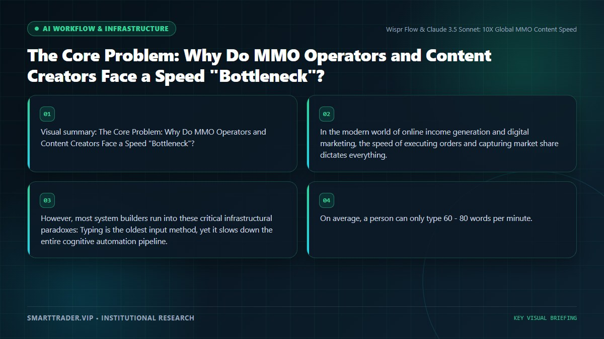
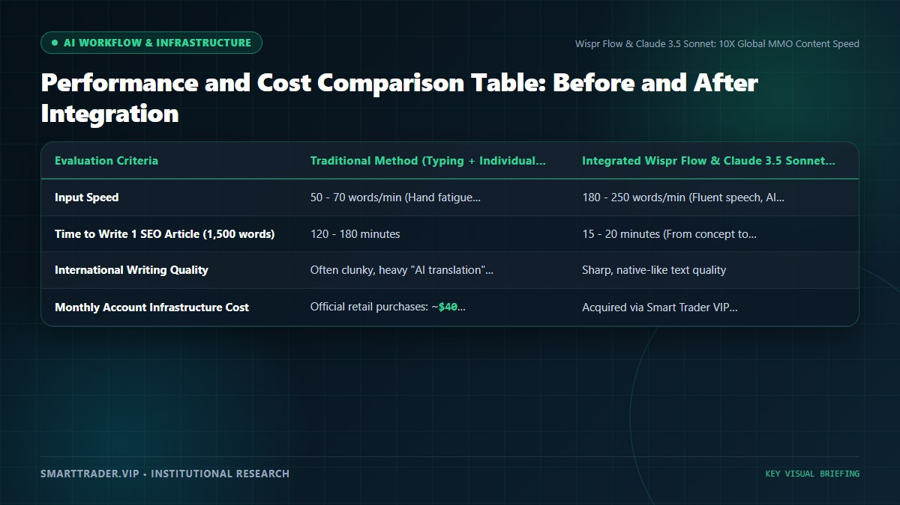

Anyone working in MMO (Make Money Online), running international marketing campaigns, or building global content systems is certainly too familiar with this scene: sitting in front of the screen from morning till night, wrists aching, back hunched over from relentless typing. Having to edit dozens of SEO-optimized articles, script short-form videos in English, or write hundreds of copywriting samples every day is completely draining the energy of strategic minds. No matter how fast your mechanical keyboard typing speed is, it can never keep up with the velocity of your thoughts—not to mention how language barriers stifle productivity.

That is when you need the intersection of today's two most advanced technologies: **integrating Wispr Flow and Claude 3.5 Sonnet**. This is not merely a productivity hack, but a revolution in data input and natural language processing infrastructure that completely frees your hands and optimizes content creation capacity by 10x.

## The Core Problem: Why Do MMO Operators and Content Creators Face a Speed "Bottleneck"?

*Visual summary: The Core Problem: Why Do MMO Operators and Content Creators Face a Speed "Bottleneck"?*

In the modern world of online income generation and digital marketing, the speed of executing orders and capturing market share dictates everything. However, most system builders run into these critical infrastructural paradoxes:

### 1. The Bottleneck of Traditional Input Speed
Typing is the oldest input method, yet it slows down the entire cognitive automation pipeline. On average, a person can only type 60 - 80 words per minute. Meanwhile, human thought and speech velocity can reach 150 - 200 words per minute. Transferring ideas from the brain -> typing -> spell-checking -> structuring sentences breaks the flow of thought and consumes massive amounts of neural energy.

### 2. The Limitations of Generic Voice Input Tools
Many operators have tried mainstream speech-to-text tools. What are the results? Rife with spelling errors, a complete lack of understanding of MMO/Crypto/Marketing industry jargon, and above all, an inability to automatically remove filler words and stutters ("um," "ah," "like"). The resulting raw text often takes more time to edit than simply typing it from scratch.

### 3. Expensive Operating Costs for Licensed Accounts
To produce high-quality content targeting the international market, you are forced to use the world's most powerful super AIs available today, such as Claude 3.5 Sonnet. However, purchasing individual official accounts at retail market prices significantly inflates the monthly infrastructure "burn rate," eating away at the profit margins of MMO campaigns.

> 💡 **Tactical Note:** Never use free solutions or low-quality floating tools. AI infrastructure and input tools are strategic weapons; investing in the wrong place means you will lose money and leak campaign data to third parties.

---

## The Breakthrough Solution: The Wispr Flow and Claude 3.5 Sonnet Integration Workflow for 10x Productivity

To thoroughly solve the problems of aching wrists and content production speed, the Smart Trader VIP infrastructure system proposes a closed-loop workflow combining **Wispr Flow** (the ultimate AI voice input tool allowing natural speech, auto-correction, and formatting) and **Claude 3.5 Sonnet** (the planet's sharpest AI for language analysis and editing).

### Step 1: Set Up Wispr Flow as the High-Speed Voice Input Gateway
Wispr Flow acts as an intelligent middleware layer sitting between your voice and any application on your computer.
- Instead of typing, you simply trigger Wispr Flow's hotkeys and speak your thoughts in natural language (both English and Vietnamese flow exceptionally smoothly).
- Wispr Flow's AI algorithm automatically strips out filler words, understands punctuation, formats paragraphs precisely as intended, and pumps clean text straight into your application screen at up to 5x the speed of regular typing.

### Step 2: Feed Raw Data into Claude 3.5 Sonnet for Refinement and Expansion
As soon as the raw stream of thought is inputted via voice, feed it directly into **Claude 3.5 Sonnet** using pre-optimized prompts.
- Claude 3.5 Sonnet possesses deep context comprehension (large Context Window), superior logical reasoning, and a natural writing style comparable to a native speaker.
- Ask Claude to transform that raw idea snippet into a complete SEO-optimized article, a viral TikTok video script, or an Email Marketing campaign targeting the US/EU market in mere seconds.

### Step 3: Automate the Workflow with n8n or Python (Optional Expansion)
For large-scale MMO system builders, you can integrate the APIs of Wispr Flow and Claude through automated n8n workflows. Read your script aloud via voice -> Claude automatically breaks it down into 10 different content variations -> Push them straight to social media pages or blog systems via API without touching your mouse.

---

## Performance and Cost Comparison Table: Before and After Integration

*Visual summary: Performance and Cost Comparison Table: Before and After Integration*

To clearly see the economic value and work performance delivered by this solution, look at the actual data breakdown below:

| Evaluation Criteria | Traditional Method (Typing + Individual AIs) | Integrated Wispr Flow & Claude 3.5 Sonnet Solution |
| :--- | :--- | :--- |
| **Input Speed** | 50 - 70 words/min (Hand fatigue, interrupted thought flow) | 180 - 250 words/min (Fluent speech, AI auto-formatting) |
| **Time to Write 1 SEO Article (1,500 words)** | 120 - 180 minutes | 15 - 20 minutes (From concept to completion) |
| **International Writing Quality** | Often clunky, heavy "AI translation" feel | Sharp, native-like text quality |
| **Monthly Account Infrastructure Cost** | Official retail purchases: ~$40 - $60/month | Acquired via Smart Trader VIP repository: Save 60-80% |
| **System & Account Stability** | Prone to errors, disconnections, workflow disruptions | Clean infrastructure, 24/7 stability, technical support |

---

## 🌐 Licensed AI Resource & Automated MMO Infrastructure Repository

Clean infrastructure and stable licensed tools are the foundational factors determining the success or failure of every MMO & Automation project:

- 🛒 **Comprehensive Repository of 84+ Wholesale AI & MMO License Tools:** Explore all 6 tool categories (Super AIs, Coding Cloud, Creative Video/Voice, Clean VPNs & Digital Accounts) at [MMO Infrastructure & AI Repository (https://tintucnft.com)](https://smarttrader.vip/mmo-infrastructure).
- ⚡ **24/7 Automated Purchasing:** Transact and receive accounts/license keys instantly in 30 seconds via Telegram bot: [Automated Purchase Bot (@chatgpsplusbot)](https://t.me/chatgpsplusbot).
- 🤖 **Verify Myfxbook EA Bot Performance:** Access [MT5 EA Trading Bots (https://tintucnft.com)](https://smarttrader.vip/automated-bot-trading) immediately to review real track records with a Max Drawdown of under 10%.
- 🎁 **Exclusive Lead Magnet Gift:** Receive an **Official GPM Login License (Free Key Gifted)** along with a bundle of **50+ AI Prompts & Workflows** for automation: [Message Admin (@willrich)](https://t.me/willrichus).
- ✈️ **Daily Signal & Strategy Updates:** Join the [MCG Community Telegram Channel](https://t.me/channelmcg) right now so you never miss urgent market alerts.