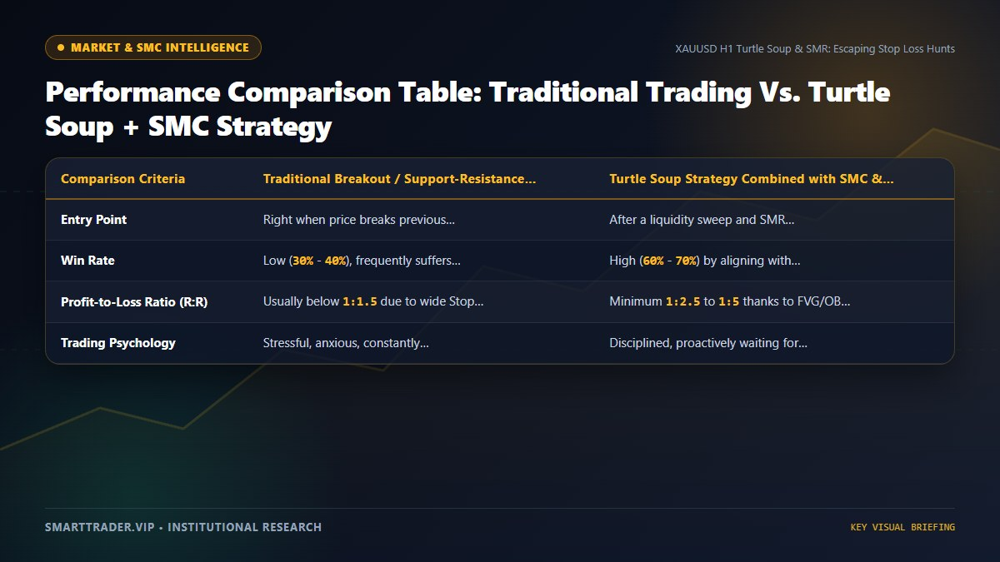

Have you ever wondered why your Buy order was just matched right at the H1 timeframe support, or your Sell order just touched the previous high, only for a powerful Stop Hunt candle to instantly appear and knock out your entire position, right before the market reverses precisely in line with your original analysis? That is not a coincidence, nor is it standard risk. That is the ultimate liquidity trap set by Market Makers (Smart Money).

The phenomenon of the **gold xauusd stop loss sweep liquidity trap** on the H1 timeframe is currently the nightmare of thousands of traders who trade using traditional technical analysis schools. When the crowd reaches a consensus on a pattern, that is precisely when Smart Money accumulates positions.

---

## 1. Decoding the Core Issue: Why Traders Repeatedly Fall into the H1 Gold Stop Hunt Trap

*Gold bullion, Bitcoin, and a padlock representing liquidity and price traps in the financial markets.*

Financial markets, especially gold (XAUUSD), operate based on liquidity. For large financial institutions or central banks to execute enormous order volumes (Institutional Order Blocks), they need a massive pool of pending orders (Buy Stop/Sell Stop) or retail investors' stop losses to act as bait.

### The Liquidity Infrastructure Paradox on XAUUSD
- **Price Pattern Traps:** The crowd frequently places breakout orders when prices break the Asian Session High/Low or trendlines.
- **Market Maker Liquidity Thirst:** **Buy-side Liquidity (BSL)** and **Sell-side Liquidity (SSL)** zones located just above old highs and below old H1 lows serve as the "fuel" for Smart Money to execute sweeps.
- **Inevitable Consequences:** Traders are repeatedly subjected to unfair stop-loss sweeps, triggering psychological panic, leading to revenge trading, and rapidly blowing up accounts within just a few trading sessions.

> 💡 **Practical Note:** Market Makers do not care how good your analysis is. They only care where your money is sitting on the H1 chart. If you place your Stop Loss right behind a glaringly obvious high or low, you are turning yourself into liquidity for the sharks.

---

## 2. The "Turtle Soup" Strategy Combined with SMR (Smart Money Reversal): The Technique to Evade Fakeout Orders

To survive and win in this environment where big fish eat small fish, we must deploy the ultimate combination of the **Turtle Soup** methodology (trading false breakouts) and **SMR (Smart Money Reversal)** through the lens of Volume Spread Analysis (VSA).

### Step 1: Identify the Target Liquidity Pool
Observe the H1 chart of XAUUSD, marking out the following zones:
- **Asian High / Asian Low** or **London Session High / Low**.
- Equal Highs (EQH) or Equal Lows (EQL). These act as price magnets.

### Step 2: Wait for the Liquidity Sweep
Do not rush to enter a trade the moment price touches a high or low. Patiently observe how price reacts:
- Price pushes straight through the previous H1 high (e.g., sweeping past $2380), creating excitement for traders entering breakout buy orders.
- However, this is a **False Breakout**. Liquidity has been completely vacuumed up.

### Step 3: Confirm Smart Reversal Signals (SMR & BOS)
Immediately following the sweep, smart money leaves its footprints via VSA and SMC signals:
- **CHoCH (Change of Character):** The H1 trend abruptly shifts structure, breaking the most recent bearish/bullish structure accompanied by a Wide Spread Candle with abnormally high trading volume (High Volume).
- **Order Block (OB) or Fair Value Gap (FVG):** Identify the supply-demand imbalance zone that appears right after the CHoCH. This is the precise boarding station to execute your Entry.

---

## 3. Performance Comparison Table: Traditional Trading Vs. Turtle Soup + SMC Strategy

*Visual summary: 3. Performance Comparison Table: Traditional Trading Vs. Turtle Soup + SMC Strategy*

| Comparison Criteria | Traditional Breakout / Support-Resistance Trading | Turtle Soup Strategy Combined with SMC & SMR |
| :--- | :--- | :--- |
| **Entry Point** | Right when price breaks previous highs/lows (Vulnerable to traps) | After a liquidity sweep and SMR confirmation |
| **Win Rate** | Low (30% - 40%), frequently suffers stop-loss sweeps | High (60% - 70%) by aligning with Market Makers |
| **Profit-to-Loss Ratio (R:R)** | Usually below 1:1.5 due to wide Stop Losses | Minimum **1:2.5 to 1:5** thanks to FVG/OB optimization |
| **Trading Psychology** | Stressful, anxious, constantly psychologically manipulated | Disciplined, proactively waiting for traps to manifest |

---

## 4. H1 Gold XAUUSD Trading Setup Parameters (Standard Setup R:R > 1:2.5)

Below is the parameter setup table for a typical Sell order following a liquidity trap sweep at the H1 timeframe high:

| Strategy Parameter | Reference Price / Price Zone | SMC Technical Explanation |
| :--- | :--- | :--- |
| **Trap Structure** | Swept past H1 high ($2385.00) | Crowd's Buy Stop orders triggered and hit Stop Loss |
| **Smart Money Footprint** | Strong bearish CHoCH down to $2370.00 | Indicates institutional participation driving prices down |
| **Entry Zone** | **$2378.00 - $2380.00** | H1 **Order Block (OB)** or **Fair Value Gap (FVG)** zone |
| **Stop Loss** | **$2387.00** | Placed safely just above the liquidity sweep wick |
| **Take Profit** | TP1: **$2360.00** / TP2: **$2345.00** | Opposite liquidity zone (Sell-side Liquidity) |
| **Risk:Reward Ratio** | **1:2.8 to 1:4.2** | Ensures professional capital management standards |

---

## 5. Conclusion

Trading gold XAUUSD on the H1 timeframe is no place for haste. Understanding the nature of the **gold xauusd stop loss sweep liquidity trap** transforms you from the position of "prey" into an intelligent observer of smart money flows. By applying the Turtle Soup model combined with SMC and SMR structures, you will always stay one step behind the crowd yet one step ahead of actual price movements.

---

## ⚡ Track Real-time Trading Signals & SMC Market Insights

Do not let sudden wick sweeps drain your capital:

- 📊 **Real-time Signal Feed:** Access [Trading Signal VIP](https://smarttrader.vip/vip-trading-signals) to monitor Gold & Crypto positions updated every minute.
- 🤖 **Verify Myfxbook EA Bot Performance:** Access [Automated Bot Trading](https://smarttrader.vip/automated-bot-trading) instantly to review live track records with a Max Drawdown under 10%.
- ✈️ **Daily Signals & Strategy Updates:** Join the [MCG Community Telegram Channel](https://t.me/channelmcg) right now so you never miss critical market alerts.
- 💬 **Signal Group Access Requirements:** [Contact Support Admin (@willrichus)](https://t.me/willrichus) for consultation on activating international-standard partner accounts.