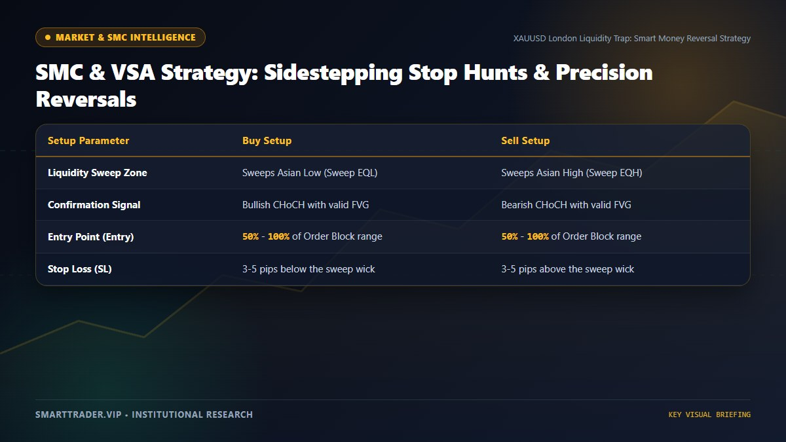

## Decoding the London Session "Stop Hunt" Nightmare

*Close-up of a clock face in a signature green hue, marking the opening of the volatile London trading session.*

Whenever the clock strikes 15:00 ICT (the start of the London session), thousands of XAUUSD traders fall right into a familiar trap: Price suddenly surges, breaking the previous Asian session high or low to trigger an extremely high-probability **Breakout** signal. You feel excited, chasing the move or placing a pending order at an **Order Block**. But just 5 minutes later, a violent rejection candle (wick) wipes out your **Stop Loss** before reversing precisely in the direction of your original analysis.

This is not market randomness—it's the classic money-manipulation art of Smart Money. Failing to understand how the market operates liquidity guarantees that you will remain a victim of Stop Hunt sweeps. This article from Smart Trader VIP breaks down the root psychology of market makers, helping you transform **the London session XAUUSD liquidity trap** into a golden opportunity to optimize your R:R ratio beyond 1:2.5.

---

## The Core Nature of the London Session Liquidity Trap (Stop Hunt)

### Institutional Cash Flow vs. Retail Liquidity
The global gold market (XAUUSD) is regulated by Market Makers (MMs)—central banks and large hedge funds handling massive order volumes. They cannot execute billion-dollar orders without causing slippage. Therefore, they need a "counterparty" to accumulate or distribute inventory, and retail traders placing orders based on basic textbooks fit the bill perfectly.

The Asian session often moves in consolidation or a tight range. During this time, retail traders continuously establish traditional support/resistance levels while placing Stop Losses just above previous highs or below previous lows. This forms the massive "liquidity pool" targeted by Smart Money.

### The Mechanism Triggering False BOS and CHoCH
Before the main trend of the London or New York session kicks off, Market Makers typically execute a **Liquidity Sweep**.
* Price forms a fake **Break of Structure (BOS)** beyond the Asian session range.
* This triggers FOMO among breakout buyers (Buy Stop) or hits the Stop Losses of prior sellers.
* As soon as sufficient liquidity (fuel) is gathered, their algorithms immediately reverse sharply, creating a **Change of Character (CHoCH)** that confirms a local structural shift.

> 💡 **Practical Note:** Never trade Asian session breakouts with the naked eye. 90% of early London session breakouts are liquidity traps unless accompanied by an explosion in trading volume via Volume Spread Analysis.

---

## SMC & VSA Strategy: Sidestepping Stop Hunts & Precision Reversals

*Visual summary: SMC & VSA Strategy: Sidestepping Stop Hunts & Precision Reversals*

To survive and win in this brutal gold market, you must think contrarian to the crowd. Below is a 4-step strategic system combining Smart Money Concept and Volume Spread Analysis.

### Step 1: Identify "Potential Inducement" Zones (IDD)
Before the London session opens (around 14:00 - 14:45 ICT), mark the highest and lowest boundaries of the Asian session. Look for double liquidity accumulation zones (Equal Highs - EQH or Equal Lows - EQL). These serve as the perfect trap laid by Smart Money.

### Step 2: Wait for Liquidity Sweep Confirmation
Patiently sit on the sidelines when price begins sweeping the Asian session high or low. The key to identifying a genuine **Stop Hunt** rather than a true trend lies in the Volume on the M5 or M15 timeframe:
* Price breaches the Asian session high, but the candle closes back down quickly with a long wick.
* Trading Volume spikes at the wick zone, indicating institutional participation while simultaneously absorbing the crowd's buy/sell orders.

### Step 3: Seek Reversal Entries with Order Blocks (OB) and FVGs
Immediately following the liquidity sweep, price will print a **CHoCH** (Change of Character), breaking the nearest short-term structure in the opposite direction.
* Look for a valid **Order Block (OB)** or **Fair Value Gap (FVG)** formed right at the moment of the CHoCH.
* This zone leaves the footprint of institutional players—where they begin driving heavy orders in the direction of the true trend.

### Step 4: Establish Capital Management & A Minimum R:R Ratio of 1:2.5

To pass rigorous prop firm challenges like FTMO, MFF, or manage personal accounts sustainably, adhering to a Risk:Reward ratio is an absolute law for survival.

| Setup Parameter | Buy Setup | Sell Setup |
| :--- | :--- | :--- |
| **Liquidity Sweep Zone** | Sweeps Asian Low (Sweep EQL) | Sweeps Asian High (Sweep EQH) |
| **Confirmation Signal** | Bullish CHoCH with valid FVG | Bearish CHoCH with valid FVG |
| **Entry Point (Entry)** | 50% - 100% of Order Block range | 50% - 100% of Order Block range |
| **Stop Loss (SL)** | 3-5 pips below the sweep wick | 3-5 pips above the sweep wick |
| **Take Profit (TP)** | Opposite liquidity (EQH / liquidity pool) | Opposite liquidity (EQL / liquidity pool) |
| **Target R:R Ratio** | Minimum **1:2.5** to **1:4** | Minimum **1:2.5** to **1:4** |

---

## Performance Comparison: Traditional Trading vs. Smart Trader VIP SMC System

| Evaluation Criteria | Traditional Support/Resistance Trading | Smart Trader VIP Standard SMC & VSA Strategy |
| :--- | :--- | :--- |
| **Average Winrate** | 35% - 40% | 60% - 68% |
| **Risk:Reward (R:R) Ratio** | Frequently below 1:1.5 | Maintains a minimum of **1:2.5 to 1:4** |
| **Stop Hunt Vulnerability** | Very high (over 70% of London sessions) | Minimized below 15% through IDD identification |
| **Prop Firm Suitability (FTMO/MFF)** | High risk of blowing accounts due to deep Drawdowns | Optimized capital management, keeping Drawdown < 8% |

---

## Conclusion: Turning Adversity Into Trading Advantage

The financial markets leave no room for emotions and naive guesswork. London session Stop Hunt sweeps actually serve as the clearest compass pointing toward where smart money is hiding. By thoroughly applying Smart Money Concept thinking—patiently waiting for liquidity traps to form, confirming CHoCH structures, and sticking to precise Order Block zones—you can fully master the game and achieve superior R:R ratios.

---
## ⚡ Track Real-time Trading Signals & SMC Insights

Don't let unexpected price wicks drain your capital:

- 📊 **Real-time Signal Feed:** Access [Trading Signal VIP](https://smarttrader.vip/vip-trading-signals) to monitor Gold & Crypto positions updated every minute.
- 🤖 **Verify EA Bot Performance via Myfxbook:** Visit [Automated Bot Trading](https://smarttrader.vip/automated-bot-trading) immediately to view live track records with a Max Drawdown under 10%.
- ✈️ **Daily Signals & Strategy Updates:** Join the [MCG Community Telegram Channel](https://t.me/channelmcg) right now so you never miss urgent market warnings.
- 💬 **Signal Group Access Requirements:** [Contact Admin Support (@willrich)](https://t.me/willrich) for professional guidance on activating standard international partner accounts.