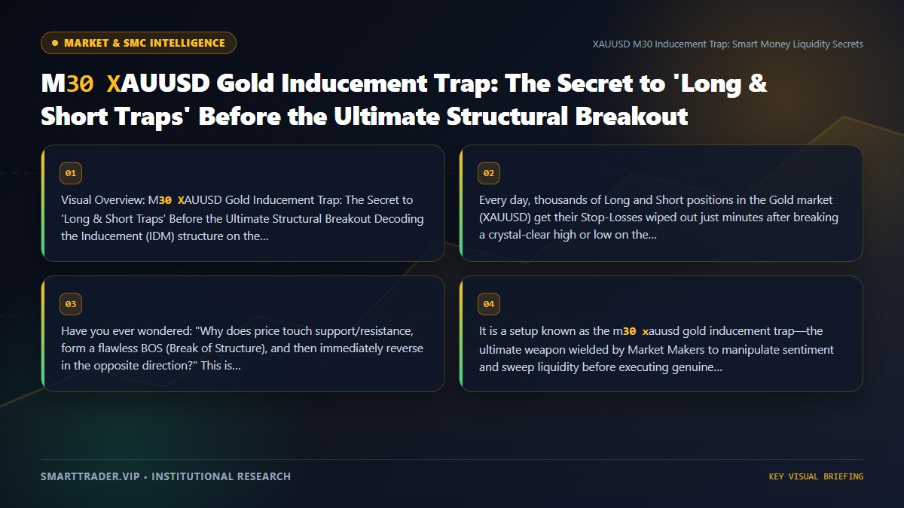
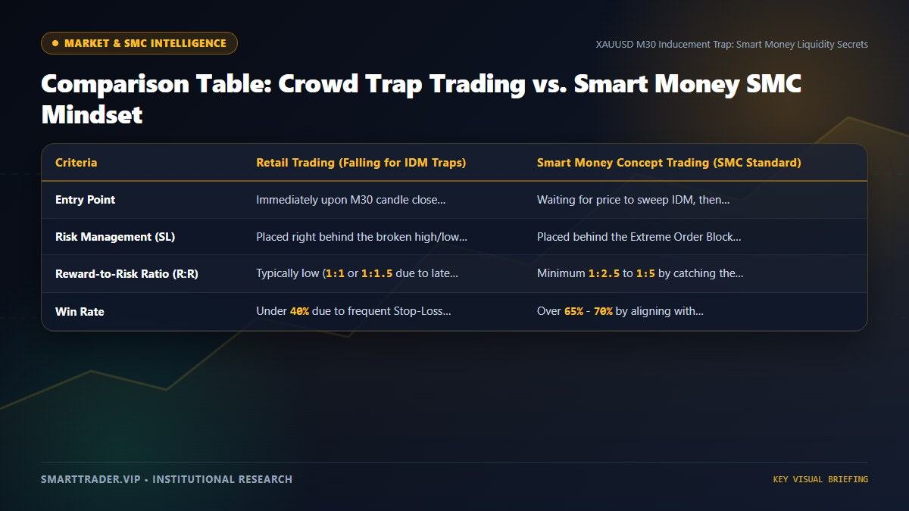

## M30 XAUUSD Gold Inducement Trap: The Secret to 'Long & Short Traps' Before the Ultimate Structural Breakout


*Visual Overview: M30 XAUUSD Gold Inducement Trap: The Secret to 'Long & Short Traps' Before the Ultimate Structural Breakout*


*Decoding the Inducement (IDM) structure on the XAUUSD Gold chart to help traders avoid liquidity traps and optimize precise Order Block entry points.*

---

Every day, thousands of Long and Short positions in the Gold market (XAUUSD) get their Stop-Losses wiped out just minutes after breaking a crystal-clear high or low on the M30 timeframe. Have you ever wondered: *"Why does price touch support/resistance, form a flawless BOS (Break of Structure), and then immediately reverse in the opposite direction?"* 

This is neither coincidence nor bad luck. It is a setup known as the **m30 xauusd gold inducement trap**—the ultimate weapon wielded by Market Makers to manipulate sentiment and sweep liquidity before executing genuine price drives. Through the lens of Smart Money Concepts (SMC) and Volume Spread Analysis (VSA), let's strip away the facade and expose this tactic.

---

## 1. The Core Nature of Inducement (IDM): The Ultimate Liquidity Bait

Within market structure, Inducement (abbreviated as IDM) refers to the secondary liquidity zones deployed by Market Makers to lure retail traders into the market prematurely, before price officially reaches the true Order Block (OB) or Mitigation Block.

### The Harsh Reality of M30 Trading Psychology
The M30 (30-minute) timeframe is a ruthless battleground for gold day-traders. Here, FOMO peaks as classic chart patterns like "breaking previous highs" or "testing support" appear continuously. Market Makers understand this well. They deliberately engineer a false structure to:
- Lure **Breakout Traders** into chasing the market (Buy Stop) upon seeing prices break resistance.
- Lure **Support/Resistance Traders** into placing short orders (Sell Stop) upon seeing prices break previous lows.

> 💡 **Practical Trading Note:** An Inducement always precedes a high-quality Order Block. Without an IDM, that Order Block is extremely vulnerable to being breached because Smart Money has not yet gathered sufficient counter-party order volume (Liquidity) to drive prices far.

---

## 2. Identifying the M30 XAUUSD Gold Inducement Trap Using SMC & VSA

To consistently avoid Smart Money liquidity traps, you must think like a market maker instead of acting on crowd emotion.

### The 4-Step Process to Spot Inducements on XAUUSD M30

1. **Identify the Higher Timeframe (HTF) Trend:** Always analyze H1 and H4 charts to establish the macro trend (Bullish or Bearish). Never trade against the macro trend on the M30.
2. **Observe the Liquidity Sweep:** As price builds an uptrend (HH - HL), the most recent high often experiences a minor pullback, creating an IDM. This is the entrapment zone.
3. **Locate the True Order Block (True OB):** This must be the last down-candle prior to a strong bullish impulsive move (in an uptrend) accompanied by price imbalance—a **Fair Value Gap (FVG)**.
4. **Examine Volume (VSA):** At the candle sweeping the IDM, trading volume usually spikes while candle bodies remain narrow or leave long wicks (Stopping Volume / Up-Thrust), signaling that institutional players are absorbing orders.

---

## 3. Comparison Table: Crowd Trap Trading vs. Smart Money SMC Mindset


*Visual Overview: 3. Comparison Table: Crowd Trap Trading vs. Smart Money SMC Mindset*


| Criteria | Retail Trading (Falling for IDM Traps) | Smart Money Concept Trading (SMC Standard) |
| :--- | :--- | :--- |
| **Entry Point** | Immediately upon M30 candle close breaking highs/lows (Breakout). | Waiting for price to sweep IDM, then pulling back to test Order Block + FVG. |
| **Risk Management (SL)** | Placed right behind the broken high/low (Highly susceptible to wick sweeps). | Placed behind the Extreme Order Block or past a safe swing structure. |
| **Reward-to-Risk Ratio (R:R)** | Typically low (1:1 or 1:1.5 due to late entry). | Minimum **1:2.5 to 1:5** by catching the origin of the wave. |
| **Win Rate** | Under 40% due to frequent Stop-Loss sweeps. | Over 65% - 70% by aligning with institutional smart money flow. |

---

## 4. Setting Up an Optimal M30 XAUUSD Trading Strategy with a 1:3 R:R Ratio

Once you master the mechanics of the **m30 xauusd gold inducement trap**, you can engineer a bulletproof trading plan with an exceptional Risk:Reward ratio.

### Sample Setup Specifications (SMC Standard)

* **Asset Pair:** XAUUSD (Gold)
* **Timeframe:** M30 (Entry) combined with H1 (Structure)
* **Entry Point:** At the **Extreme Order Block** after the IDM has been completely swept.
* **Stop-Loss:** **3 to 5 pips** beyond the Order Block wick (to filter out market noise).
* **Take-Profit:** At opposing liquidity pools (Buy-side or Sell-side Liquidity on higher timeframes), ensuring a minimum R:R of **1:2.5**.

```
[M30 Trend] ---> Forms Fake High/Low (IDM) ---> Sweeps IDM (Trap) ---> Hits True Order Block + FVG ---> Breaks Structure (BOS / CHoCH) ---> Entry 🚀
```

> 💡 **Practical Trading Note:** Do not set passive limit orders at an Order Block without seeing clear evidence of a price sweep past the Inducement. Patiently waiting for the market's "fakeout" is what separates losing traders from professional traders.

---

## ⚡ Track Real-time Trading Signals & SMC Insights

Never let sudden wick sweeps drain your capital:

- 📊 **Live Real-time Signal Feed:** Visit [Trading Signal VIP](https://smarttrader.vip/vip-trading-signals) to monitor Gold & Crypto positions updated minute by minute.
- 🤖 **Verify Myfxbook Bot EA Performance:** Visit [Automated Bot Trading](https://smarttrader.vip/automated-bot-trading) immediately to review verified track records with a Max Drawdown under 10%.
- ✈️ **Daily Signals & Strategy Updates:** Join the [MCG Community Telegram Channel](https://t.me/channelmcg) now so you never miss critical market alerts.
- 💬 **Signal Group Access Requirements:** [Contact Support Admin (@willrich)](https://t.me/willrich) for guidance on activating an institutional-grade partner trading account.